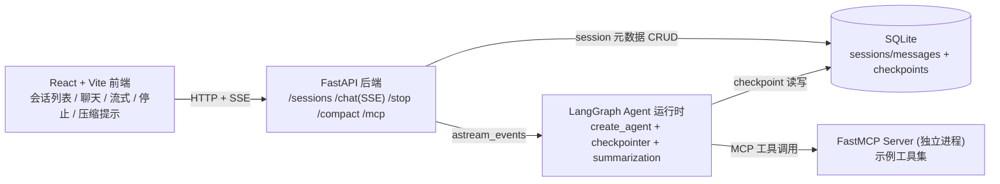

# LangGraph/LangChain Web Agent MVP —— 实施方案与进度台账

> 本文件是本项目（`jiakuan_langchain`）的**唯一实施主线与进度台账**。每完成一个阶段，更新文末「§10 进度台账」。
> 目标读者：后续接手的 agent / 协作者。开工前先读 `AGENTS.md`、`misc/任务说明.md`（本地资料，不入库）、本文件。
> **LangChain / LangGraph 使用说明（甲方约定，逐模块核查表与维护约定）见** `docs/20261104-LangChain与LangGraph使用说明.md`。
> 创建日期：2026-11-04

---

## 0. 一句话目标

用 **LangGraph + LangChain** 搭一套 **Web Agent 服务** MVP：Web 前端 + Agent 后端（LLM 工具调用循环）+ **SQLite 会话持久化 / resume / 删除** + **上下文压缩** + **FastMCP 工具接入**，形态参考 `Aivory`（前端/服务形态）与 `GenericAgent`（Python agent 后端）。

**关键定位（用户已确认）：** LangChain + LangGraph 合起来相当于 `GenericAgent` 里那套“agent 服务层”的角色。GenericAgent 是纯手写实现；本项目改用库的积木拼装。**凡 LangGraph/LangChain 原生能力能覆盖的（持久化、resume、流式、中断、压缩、工具循环），优先用原生能力，不自造。**

---

## 1. 已确认的决策与约束

| 项 | 决定 | 说明 |
|---|---|---|
| 前端形态 | **A. 轻量自建 React + Vite** | 复刻 Aivory 聊天骨架（会话列表/新建/删除/切换、流式渲染、停止、压缩提示），不做其 441 条路由 |
| 鉴权 | ~~单用户 / 无登录~~ → **多用户** | 阶段一先跑通 UI+后端+持久化+MCP；**阶段二已升级为多用户登录 + 会话隔离 + 用户级 APIKey/MCP**（见 `docs/20261104-多用户与隔离实施方案.md`） |
| 会话存储 | **SQLite** | 元数据 + 消息/checkpoint 都落同一个 SQLite 文件 |
| MCP | **自建 FastMCP server**，后端作为 client 接入 | `langchain.mcp` 与 fastmcp 2.14.4 不兼容，改用 `fastmcp.Client` 薄封装为 LangChain 工具 |
| 模型接入 | 复用根目录 `llm.yaml`，默认 `active_profile: default` → `deepseek-v4.1-flash` | `wire_api: openai_responses` → `ChatOpenAI(use_responses_api=True)` |
| 参考 | 前端抄 Aivory；后端范式抄 GenericAgent；LangGraph/LangChain 原生优先 | 见 §8 |

---

## 2. 环境事实（本机实测，2026-11-04）

- Python **3.12.4**（`python`，非 `python3`）
- 已装：`langgraph 1.2.19`、`langchain 1.4.8`、`langchain-core 1.7.4`、`langchain-openai 1.7.3`、`fastmcp 2.14.4`、`fastapi 0.135.1`、`mcp 1.26.0`、`aiosqlite 0.22.0`、`uvicorn 0.41.0`、`SQLAlchemy 2.0.30`
- **本次补装：** `langgraph-checkpoint-sqlite`（提供 `AsyncSqliteSaver`）
- Node **v24.22.1**，`npm 12.2.1`，`pnpm` 可用
- 仓库根目录**已初始化为 git 仓库**（`git init -b main`，首个提交 `chore: init repo with multi-user LangGraph agent MVP`；分支 `main`；`.gitattributes` 统一 LF；敏感文件 `llm.yaml`、运行时数据、`node_modules`、`frontend/dist`、`work/` 均已 `.gitignore`）

### 2.1 库版本的坑（务必按此写，别按记忆写）

1. `ChatOpenAI(...)` 的入参是 **`openai_api_base` / `openai_api_key`**（也接受 `base_url`/`api_key` 别名）；模型名用 **`model` 或 `model_name`**。
2. `use_responses_api=True` 时，**流式 `AIMessageChunk.content` 是内容块列表** `[{'type':'text','text':'...'}]`，不是纯字符串。SSE 转换必须按块提取 `text`。
3. `AsyncSqliteSaver` 在 `langgraph.checkpoint.sqlite.aio`；用 `AsyncSqliteSaver.from_conn_string(path)` 拿异步上下文管理器。
4. `create_agent` 签名：`create_agent(model, tools=None, *, system_prompt=None, middleware=(), checkpointer=None, store=None, state_schema=None, ...)`。
5. `SummarizationMiddleware(model, *, trigger=(...), keep=(...), token_counter=...)` 来自 `langchain.agents.middleware`。
6. `langchain.mcp` 命名空间不可用（`fastmcp.client.group` 缺失），**不要用它**；用 `fastmcp.Client`。

### 2.2 模型实测结论

- `default → deepseek-v4.1-flash`（provider `xem-deepseek-v41-flash-responses`，`base_url=https://ai.xem8k5.top/v1`，`wire_api=openai_responses`，`context_window=256000`，软线 `115200`）。
- 非流式 / 流式请求均已打通（返回内容正常；终端乱码只是 GBK 显示问题）。
- 流式前 2 个 chunk 的 `content` 为空列表（reasoning/role 阶段），需跳过空块。


---

## 3. 目标架构

### 3.1 组件拓扑



### 3.2 组件职责

| 组件 | 职责 | 对应 GenericAgent / Aivory |
|---|---|---|
| React 前端 | 会话列表/新建/删除/切换、聊天流式渲染、停止、压缩状态展示 | Aivory `src/` 聊天骨架 |
| FastAPI 后端 | HTTP/SSE 网关：会话 CRUD、发起生成、停止、手动压缩、MCP 工具清单；**不直接碰模型细节** | Aivory Go gateway / GenericAgent `app.py` |
| LangGraph 运行时 | Agent 工具循环、状态/对话历史、checkpoint 持久化与 resume、上下文压缩 | GenericAgent `core/loop.py` + `handler.py`；本次用库替代 |
| LLM 适配层 | 解析 `llm.yaml` → 构造 `ChatOpenAI`；统一 `use_responses_api` 流式差异 | GenericAgent `llm/config.py` + `core.py` |
| FastMCP Server | 暴露示例工具（time/calc/kv 等），独立进程 | Aivory `internal/mcp`；GenericAgent `mcp/runtime.py` |
| SQLite 存储 | `sessions`/`messages` 元数据表 + LangGraph checkpoint 表（同一 DB 文件） | Aivory store 层；GenericAgent sessions |

### 3.3 目录结构（清晰优先）

```
jiakuan_langchain/
├── AGENTS.md                 # 已存在（项目铁律）
├── misc/任务说明.md           # 本地资料（.gitignore 忽略）
├── llm.yaml                  # 已存在（模型配置，勿改）
├── docs/
│   ├── 20261104-实施方案与进度.md   # 本文件（进度台账）
│   └── ...
├── backend/
│   ├── requirements.txt
│   ├── app/
│   │   ├── __init__.py
│   │   ├── main.py           # FastAPI 装配 + lifespan + 静态托管
│   │   ├── config.py         # llm.yaml 解析 + 运行配置
│   │   ├── db.py             # SQLite 引擎/建表 + session 元数据 DAO
│   │   ├── schemas.py        # Pydantic 请求/响应模型（对齐前端契约）
│   │   ├── llm.py            # 构造 ChatOpenAI（含 use_responses_api 处理）
│   │   ├── agent.py          # 组装 create_agent + checkpointer + middleware + MCP tools
│   │   ├── mcp_client.py     # fastmcp.Client → LangChain tool 封装
│   │   ├── sse.py            # astream_events → 统一 SSE 事件（message_start/text_delta/thinking_delta/tool_*/done/error）
│   │   └── routers/
│   │       ├── sessions.py   # /api/sessions CRUD + 历史消息
│   │       ├── chat.py       # POST /api/sessions/{id}/messages (SSE) + /stop + /compact
│   │       └── mcp.py        # /api/mcp/tools 调试
│   ├── mcp_server/
│   │   └── server.py         # FastMCP：示例工具
│   └── data/                 # 运行期 SQLite（运行时生成，gitignore）
├── frontend/
│   ├── package.json
│   ├── vite.config.ts        # /api 代理到后端
│   ├── index.html
│   └── src/
│       ├── main.tsx / App.tsx
│       ├── api.ts            # fetch + SSE 解析（抄 Aivory client.ts 思路）
│       ├── types.ts
│       └── components/       # Sidebar / ChatThread / MessageRow / Composer
└── .gitignore
```


---

## 4. API 契约（前后端对齐）

> 命名对齐 Aivory 的 `conversationsApi`，但简化为 MVP 子集。ID 用 `co_`/`msg_` 前缀 + 短 hex，时间戳毫秒。

### 4.1 会话 CRUD

| 方法 | 路径 | 说明 | 返回 |
|---|---|---|---|
| GET | `/api/sessions?limit=&offset=` | 会话列表（按 updated_at 倒序） | `{sessions:[Session], has_more}` |
| POST | `/api/sessions` | 新建会话（body: `{title?}`） | `Session` |
| GET | `/api/sessions/{id}` | 会话详情 + 历史消息 | `{session:Session, messages:[Message]}` |
| PATCH | `/api/sessions/{id}` | 改标题/置顶等 | `Session` |
| DELETE | `/api/sessions/{id}` | 删除会话（同时删 checkpoint/消息，删 thread） | `{ok:true}` |
| GET | `/api/sessions/{id}/messages` | 历史消息（供 resume 回放，path 模式） | `[Message]` |

`Session`（对齐 `ApiConversation` 精简版）：
```json
{"id":"co_xxxxxxxx","user_id":"local","title":"新会话","model_id":"deepseek-v4.1-flash",
 "provider":"xem-deepseek-v41-responses","created_at":0,"updated_at":0,
 "message_count":0,"pinned":false,"archived":false,
 "compaction":{"compacted":false,"summary_tokens":0,"kept_messages":0}}
```

`Message`（对齐 `ApiMessage` 精简版）：
```json
{"id":"msg_xxxxxxxx","session_id":"co_...","role":"user|assistant","content":"...",
 "reasoning":"...","blocks":[...],"status":"complete|streaming|error|stopped",
 "tool_calls":[...],"created_at":0}
```

### 4.2 聊天（SSE 流式）

`POST /api/sessions/{id}/messages`，body：
```json
{"text":"...", "generation_id":"g_xxx"}
```

响应 `text/event-stream`，**帧格式**（对齐 Aivory client.ts）：
```
event: message
data: {"type":"...", ...}
id: <单调序号>

```
（`parseSSEFrame` 兼容 `event:`/`data:`/`id:` 三字段，`data` 为 JSON，帧以 `\n\n` 分隔。）

**事件类型**（后端必须按此发送）：

| type | 字段 | 前端行为 |
|---|---|---|
| `message_start` | `message_id` | 收到即建占位 assistant 消息、重键 |
| `text_delta` | `text` | 追加正文 |
| `thinking_delta` | `text` | 追加思考轨迹（reasoning） |
| `tool_start` | `id,name,input` | 新建工具步骤 |
| `tool_input` | `id,partial_json` | 累积工具入参 |
| `tool_result` | `id,content,is_error` | 回填工具结果 |
| `compaction` | `dropped,kept,summary_tokens` | 顶部提示“已压缩上下文” |
| `done` | `message_id, usage` | 正常结束、落库 |
| `error` | `error` | 异常结束 |

`POST /api/sessions/{id}/stop`：body `{message_id?, generation_id?}` → `{ok:true}`；服务端中断该 run、持久化已产出部分、状态置 `stopped`。
`POST /api/sessions/{id}/compact`：手动触发压缩 → `{compacted, dropped_messages, kept_messages, summary_tokens}`。

### 4.3 MCP 调试

| 方法 | 路径 | 说明 |
|---|---|---|
| GET | `/api/mcp/tools` | 返回当前接入的 MCP 工具清单（name/description/args schema） |

### 4.4 健康检查

`GET /api/health` → `{ok:true, model:"deepseek-v4.1-flash", mcp_tools:N}`


---

## 5. 关键技术设计

### 5.1 Agent 组装（LangGraph 原生优先）

```python
# backend/app/agent.py （目标形态）
from langchain.agents import create_agent
from langchain.agents.middleware import SummarizationMiddleware
from langgraph.checkpoint.sqlite.aio import AsyncSqliteSaver

def build_agent(model, tools, summarizer, checkpointer):
    return create_agent(
        model,
        tools=tools,
        system_prompt=SYSTEM_PROMPT,
        middleware=[SummarizationMiddleware(
            model=summarizer,
            trigger=("tokens", SOFT_LIMIT_TOKENS),   # 软线摘要
            keep=("messages", 20),
        )],
        checkpointer=checkpointer,                    # AsyncSqliteSaver
        state_schema=None,
    )
```

- `thread_id = session_id`：一次会话 = 一个 LangGraph thread，天然支持 resume。
- 历史消息来自 checkpoint（`get_state`/`aget_state`），同时落一份 `messages` 表供前端 `GET /messages` 快速回放（双写，元数据表是前端真相源，checkpoint 是运行时真相源）。

### 5.2 持久化 & resume

- 单一 SQLite 文件 `backend/data/app.db`：
  - 业务表：`sessions`、`messages`；`PRAGMA journal_mode=WAL`。
  - LangGraph 表：`AsyncSqliteSaver` 自建（`checkpoints`、`writes` 等），用同一文件、独立连接。
- **resume**：前端选中会话 → `GET /api/sessions/{id}` 返回元数据 + 历史消息直接渲染；下次发消息时以同 `thread_id` 继续 `astream_events`，checkpointer 自动接上历史。
- **删除**：事务内删 `sessions`+`messages`；再调用 checkpointer 删该 thread 的 checkpoint（`adelete_thread`，若版本无则直接按 thread_id 删表行）。

### 5.3 上下文压缩

- 主用 **`SummarizationMiddleware`**（token 触发，`token_counter` 默认 `count_tokens_approximately`；中文偏低估，需实测校准）。
- 触发后由中间件写一条摘要替换旧历史；我们额外：
  - 在 `astream_events` 中检测到压缩发生 → 发 `compaction` SSE 事件（顶部提示）。
  - 更新 `sessions.compaction` 字段（`compacted/summary_tokens/kept_messages`）。
- 手动 `/compact`：直接调用一次性摘要（复用中间件的 summarizer 模型），写回并把结果告知前端。
- **降级方案**：若 `SummarizationMiddleware` 与该模型的 responses 流不适配，则退回“自算 token（CJK-aware）+ 保留最近 N 条 + 早段摘要”的手写压缩（参照 GenericAgent `compress_history_tags` 思路）。

### 5.4 MCP 接入

- `backend/mcp_server/server.py`：`FastMCP("demo-tools")`，注册：
  - `current_time(timezone?)`、`calculator(expression)`、`echo(text)`、`kv_set/kv_get`（演示有状态工具）。
- 后端 `mcp_client.py`：用 `fastmcp.Client(server)`（可 in-process 传入 FastMCP 实例或 stdio/http URL）→ `list_tools()`/`call_tool()` → 封装成 LangChain `StructuredTool`：
  - `name`、`description`、`args_schema`（由 MCP inputSchema 转 Pydantic / 或直接透传 dict schema）。
  - 调用时 `await client.call_tool(name, args)`，把结果转字符串。
- **启动方式**：MVP 用 in-process `FastMCP` 实例直连（最省事、无端口），同时保留 `MCP_SERVER_URL` 走 HTTP/stdio 的开关，方便未来独立进程。
- `langchain.mcp` 不可用，写在代码注释里说明原因。

### 5.5 停止生成

- 每次生成分配 `generation_id`；后端维护 `{session_id: {generation_id: asyncio.Task/Event}}`。
- `/stop`：set 取消事件 → 中断 `astream_events` 迭代 → 保存已产出的 assistant 部分消息（status=`stopped`）→ SSE 侧发 `done`（或前端直接 abort 本地流）。
- MVP 单副本，进程内取消即可（不做 Aivory 的跨实例 pub/sub 停止——那是多副本才需要）。

### 5.6 LLM 适配（llm.yaml）

- `config.py` 读 `llm.yaml`：`active_profile → profiles[].model → models[].provider → providers[]`。
- 构造 `ChatOpenAI(model=api_model, base_url=base_url, api_key=api_key, use_responses_api=(wire_api=='openai_responses'), temperature, max_tokens, timeout, max_retries)`。
- `reasoning_effort` / `thinking` 字段按需透传（responses 线走 `reasoning`）。
- **不改 llm.yaml**（含真实 key，已被项目视为不可提交，但我们只读不写）。


---

## 6. 实施阶段（每阶段可独立验证）

| 阶段 | 内容 | 交付物 | 验证方式 |
|---|---|---|---|
| **P0** 骨架 | 目录、`requirements.txt`、`config.py`(llm.yaml 解析)、`.gitignore`、健康检查 | 后端能起、`/api/health` 通 | `uvicorn` 起服务 + curl |
| **P1** 会话持久化 | SQLite `sessions/messages` DAO、`/api/sessions` CRUD、ID 生成 | 会话增删改查 | curl / 脚本 CRUD 往返 |
| **P2** Agent+SSE | `agent.py`(create_agent+checkpointer)、`/messages` SSE、事件转换 | 多轮流式对话 | 脚本消费 SSE，断言 message_start/text_delta/done |
| **P3** resume/删除 | thread_id=session_id、历史回放、删除同步删 checkpoint | resume 后上下文连续；删除干净 | 两轮对话后重启服务再续聊 |
| **P4** 上下文压缩 | SummarizationMiddleware + `compaction` 事件 + 手动 `/compact` | 长对话触发压缩、字段更新 | 灌长历史触发软线，观察 compaction |
| **P5** MCP 接入 | FastMCP server + client 封装 + `/api/mcp/tools` | 模型能调用 MCP 工具 | 问“现在几点/算 12*13”，观察 tool_* 事件 |
| **P6** 前端 | React+Vite：侧边栏+聊天+流式+停止+压缩提示+删除/resume | 可交互 Web UI | 浏览器全流程手测 |
| **P7** 联调打磨 | 静态托管、错误处理、README、跑通全链路 | 可演示 MVP | 端到端演示脚本 |

### 6.1 每阶段完成定义（DoD）
- 代码可运行、无报错；
- 该阶段验证命令输出符合预期（贴到 §10）；
- 更新 §10 台账（状态 + 证据 + 下一步）。

---

## 7. 验证基线（MVP 验收）

- **对话**：多轮对话，流式逐字渲染；`message_start` 先到。
- **resume**：关闭/重启服务后，选中旧会话继续聊，模型能看到此前上下文。
- **删除**：删除会话后列表消失、DB 无残留、checkpoint 无残留。
- **压缩**：长对话达到阈值后自动摘要，前端出现压缩提示，后续仍连贯。
- **MCP**：模型自主调用 MCP 工具完成请求（如时间/计算），事件可见。
- **停止**：生成中可停止，已产出内容保留。

---

## 8. 参考映射（抄什么 / 不抄什么）

| 需求 | 参考来源 | 采用方式 |
|---|---|---|
| SSE 帧解析、事件类型 | Aivory `src/api/client.ts`、`前端-02` | 抄帧格式与事件名（`message_start/text_delta/thinking_delta/tool_*/done/error`） |
| 会话 CRUD、字段结构 | Aivory `src/api/endpoints.ts`、`types.ts` | 抄精简版字段（`Session`/`Message`） |
| 前端聊天骨架 | Aivory `src/components/chat/*`、`src/pages/chat/*` | 抄布局/交互，做轻量实现 |
| Agent 循环/工具分发 | GenericAgent `core/loop.py`、`core/handler.py` | **不直接抄**，用 LangGraph `create_agent` 替代；仅参考行为语义 |
| 上下文压缩思路 | GenericAgent `llm/core.py::compress_history_tags`、Aivory `compaction*.go` 文档 | 参考“软线摘要+硬线裁剪+CJK token 估计”；优先库原生 |
| llm.yaml 解析 | GenericAgent `llm/config.py` | 参考 provider/wire_api 三级解析，简化为本项目所需字段 |
| 持久化/resume | — | **LangGraph checkpointer 原生**，不自造 |

---

## 9. 风险与应对

| 风险 | 应对 |
|---|---|
| `SummarizationMiddleware` 与 responses 流/中文 token 估计不适配 | 先小规模验证；不行即降级手写压缩（§5.3） |
| `use_responses_api` 流式块结构差异（content 为 list） | SSE 转换按块提取 text（§2.1、§5.x 已记录） |
| `AsyncSqliteSaver` 与业务表同库并发 | WAL + 独立连接；写操作串行化 |
| `fastmcp.Client` API 细节 | 先写最小连通测试（list_tools/call_tool） |
| 模型端点不稳定 | `max_retries` + 超时；llm.yaml 已有多个 provider 可切 |
| 长文本/中文写入损坏 | 遵守 AGENTS.md 分段 heredoc + UTF-8 校验 |


---

## 10. 进度台账（每阶段更新）

> 状态：⬜ 未开始 / 🟡 进行中 / ✅ 完成 / ⚠️ 有风险

| 阶段 | 状态 | 证据（命令/输出/文件） | 下一步 |
|---|---|---|---|
| 调研+方案 | ✅ | 已读 AGENTS.md / misc/任务说明.md / 选型报告 / Aivory 分析docs / GenericAgent 核心 / 库 API 实测 | 进入 P0 |
| P0 骨架 | ✅ | `backend/app/{config,llm,main}.py`；`/api/health` 返回 `{ok,model,mcp_tools:5}` | P1 |
| P1 会话持久化 | ✅ | `backend/app/db.py` DAO；`/api/sessions` CRUD 往返通过（创建/列表/详情/改/删） | P2 |
| P2 Agent+SSE | ✅ | `agent.py`+`sse.py`；SSE 事件 `message_start/tool_start/tool_result/text_delta/done` 全通；calculator(25*4)=100 | P3 |
| P3 resume/删除 | ✅ | 同 thread 追问「100+1」→101，上下文连续；删除后 404 且 checkpoint 清理 | P4 |
| P4 上下文压缩 | ✅ | 三级机制：手动 `/compact`（输入框指令+按钮，可见摘要卡）/ 自动软线摘要（中间件，去重）/ 硬线裁剪兜底；阈值可按用户配置并留空派生。详见 `docs/20261104-上下文压缩方案与进度.md` | P5 |
| P5 MCP 接入 | ✅ | `mcp_server/server.py` 5 工具 + `mcp_client.py` 转 LangChain 工具；模型自主调用 time/calc | P6 |
| P6 前端 | ✅ | `frontend/` React+Vite 完整；真实浏览器 E2E：新建/流式渲染/工具卡/刷新持久化，0 控制台错误；截图 `misc/ui_screenshot_light.png` | P7 |
| P7 联调打磨 | ✅ | 默认配置全新启动整链 PASS（9801→9800 上下文连续）；停止生成/删除/清理均验证；README 完成 | 完成 |
| 用户自测 | 🟡 | 交付用户自行测试中；后端已在 `127.0.0.1:8000` 运行、`/api/health` ok、`/` 返回 200；测试方法见 `docs/20261104-测试方法与访问说明.md` | 待用户反馈 |

### 10.1 变更记录

- 2026-11-04：创建本方案与台账；完成全部调研与库 API 实测（模型链路已打通）；决策 A（轻量 React）+ 单用户。

- 2026-11-04：后端 P0–P5 完成并端到端验证（流式/持久化/resume/自动+手动压缩/MCP 工具调用全部通过）。进入 P6 前端。
- 2026-11-04：P6 前端 + P7 联调完成。全量验收通过。MVP 可演示。

---

## 11. 访问方式（交给用户自测）

> 完整测试清单见 `docs/20261104-测试方法与访问说明.md`；多用户方案与台账见 `docs/20261104-多用户与隔离实施方案.md`。

- **后端 + 前端一体（当前已在运行）**：浏览器打开 `http://127.0.0.1:8000/`
  - 首屏为**登录/注册页**：先注册或用测试账号登录（`alice@test.com` / `bob@test.com`，密码均 `pass1234`）。
  - 登录后侧栏底部显示当前用户，可「设置」（配置我的 APIKey / 我的 MCP）与「登出」。
  - 服务由 `cd backend && python run.py` 启动（已在后台运行，PID 见 `netstat`）。
  - 前端为已构建产物 `frontend/dist`，由后端在 `/` 单端口托管。
  - 健康检查：`http://127.0.0.1:8000/api/health`。
- **前端开发模式（如需热更新）**：
  1. 后端保持运行（8000）。
  2. 另开终端：`cd frontend && npm run dev`，浏览器打开 `http://127.0.0.1:5173/`（`/api` 自动代理到 8000）。
- **停止后端**：找到监听 8000 的进程结束即可，例如
  `netstat -ano | grep :8000` 查到 PID，再 `taskkill //PID <PID> //F`。
- **自测建议路径**：新建会话 → 发「现在几点？顺便算 128*37」看工具卡与流式 → 刷新页面看历史保留 → 追问「再减 1」看上下文连续 → 侧栏悬停删除会话 → 顶栏「压缩上下文」。

> 备注：若 8000 端口被其他程序占用或你重启机器，需重新 `cd backend && python run.py` 启动。

- 2026-11-04：UI 配色改为白色系（浅底/白面板/浅蓝气泡/深色文字），重新构建前端并截图 `misc/ui_screenshot_light.png`。

- 2026-11-04：上下文压缩重构完成——新增输入框 `/compact`、可见摘要卡、自动压缩去重、硬线裁剪兜底、用户级阈值可配（清空回退派生）；API + Playwright E2E 全通过（见 `docs/20261104-上下文压缩方案与进度.md`）。

- 2026-11-04：**发布口径收敛**——仓库只放代码/文档/演示图，**不入库任何数据库与 `llm.yaml`**。
  - `backend/data/app.db`（含真实用户与 APIKey）与根目录 `llm.yaml`（含真实 key）均在 `.gitignore`，且确认**从未进入过 git 历史/远端**。
  - `llm.yaml` 降级为**可选兜底**：`/api/health` 缺文件时返回 `model=""` 而不是 500；
    用户未配模型时聊天返回可读 SSE error（提示去「设置 → 我的模型」配置），不再抛 500。
  - 前端不再把模型名硬编码成 `deepseek-v4.1-flash`，未配置时显示「未配置模型」。
  - 干净 clone 冒烟（仅 61 个 tracked 文件、无 db、无 llm.yaml）：服务正常启动、自动建空库、`/api/health` 返回 200。

- 2026-11-04：删除本机 `llm.yaml` 后的实测与修复。
  - `/api/health` 返回 `{"ok":true,"model":"","mcp_tools":0}`，前端显示「未配置模型」，服务正常启动。
  - 用户已有 LLM 配置**全部持久化保留**（`user_llm_configs` 共 8 条，含 key；会话 `model_id` 不变），登录后下拉照常可选。
  - 修复 bug：用户配了模型但**没勾默认**时，旧逻辑回退到已删除的 `llm.yaml` → 500。
    现在回退到「最早创建」的可用配置（= 下拉第一项，可预期），并一次性自愈写入 `is_default=1`。
  - 修复 `/api/me/mcp-effective`：模型不可用时不再 500，返回 `{"tools":[],"error":...}`。
  - 实测对话（`1234@qwe.com` / `123@qwe.com`）SSE 正常返回 `text_delta` 与最终 `5`。

- 2026-11-04：修复「配置完模型后下拉框不显示，必须先发一条消息才出现」。
  - 根因：模型选择器只在 `activeSession` 存在时渲染；刚注册/还没会话时看不到。
  - 修复：选择器**始终可见**——无会话时选中值作为新会话的默认模型（`pendingModelId`），
    新建会话/发消息自动建会话都会带上该值；保存配置后无需提问即可看到（`onLlmChanged` 即时刷新）。
  - 修复过程中曾引入 `currentModelId` 声明顺序问题（TDZ）导致页面白屏，已修正并在浏览器实测通过。
  - 侧栏底部无会话时同步显示当前默认模型，不再误显「未配置模型」。
  - Playwright 实测：新用户注册 → 无会话即有下拉 → 配置保存后立即出现 → 选择→新建会话→值一致。

- 2026-11-04：登录标识扩展为「邮箱或用户名」。
  - `users` 新增唯一列 `username`（`WHERE username<>''` 的部分唯一索引），旧库启动时自动迁移。
  - 历史用户 username 生成规则：昵称唯一且合法时优先用昵称，否则用邮箱 @ 前缀；冲突追加数字后缀。
  - 注册：邮箱/用户名分别做重复校验，返回可读提示；用户名限 `[A-Za-z0-9_.-]{2,32}`。
  - 登录：`identifier` 支持邮箱（含 @）或用户名（不区分大小写），并保留邮箱前缀兜底；
    旧客户端字段 `email` 仍兼容。
  - Playwright 实测：注册/用户名登录/邮箱登录/重复用户名/重复邮箱/密码错误提示全部符合预期。
