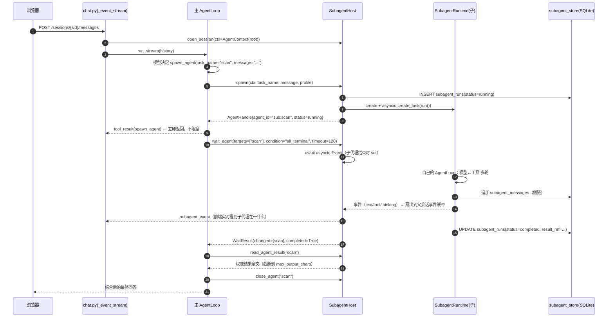

# Subagent 调研与设计方案（Web 多用户内核）

> 日期：2026-11-05 · 状态：**设计稿（尚未实施）**
> 调研对象：`D:\git_codes\GenericAgent`（GA，CLI 单机内核）、`D:\git_codes\Aivory`（Go + React 多用户 Web 服务）
> 目标读者：后续实施 P2（subagent → team/task → 计划模式 → goal → hooks）的 agent / 协作者
> 关联：`docs/20261105-去LangChain依赖-决策记录.md`（路线图）、`docs/20261105-Skill与基础工具设计与实施.md`（工具层）

---

## 0. 一句话结论

**GA 的 subagent 是「一个子代理 = 一个独立 OS 进程 + 一套文件系统 IPC」，Aivory 的「subagent」其实只是「同一 HTTP 请求内的多阶段子任务」；两者都不是我们直接要的形态。**
本项目（Web、多用户、SQLite、SSE、可能多实例）应当做 **`SubagentHost`：进程内 asyncio 子代理运行时**——每个子代理是一个**独立 `AgentLoop` + 独立侧链 history + 独立事件缓冲**，但**共享同一进程**；对外暴露 GA 同款的 `spawn_agent / wait_agent / read_agent_result / list_agents / close_agent` 工具面，并**预留**「切换到独立 worker 进程 / 任务队列」的接口。这样既能立刻支撑「主循环 + subagent」，又为后续 team / 动态工作流留出正确的扩展点。

---

## 1. 背景与目标

### 1.1 为什么现在要做 subagent

路线图（AGENTS.md §0.1）里 P2 的第一项就是 **subagent / team / task**。这三者是层层递进的：

```
subagent（能派生一个受控子代理并拿回结果）
   └── team（多个 subagent 共享任务板、互相发消息、被同一个 lead 协调）
          └── 动态工作流（由任务板 + 依赖 + 调度器驱动的、可长期运行的 agent 工作流）
```

也就是说：**没有可靠的 subagent 原语，team 和动态工作流就无从谈起**。subagent 的价值不是「显得并行」，而是三件实事：

1. **上下文隔离**：把「翻 30 个文件找线索」这种脏活放到子代理的上下文里，主上下文只收一份结论，不被海量中间产物污染。
2. **并行**：多个互不依赖的旁路任务同时推进，缩短墙钟时间。
3. **能力隔离**：子代理继承全部业务工具，但**编排工具不可见**，因此不会递归派生、不会形成失控的代理树。

### 1.2 本项目当前的真实状态（设计必须基于它，而不是想象）

读完 `backend/app` 后，与本设计相关的现状：

| 维度 | 现状 | 对 subagent 的影响 |
|---|---|---|
| 内核 | 自研 `AgentLoop`（`agent_loop.py`）：`while` 循环，模型 → 工具 → 模型 | **可直接实例化多个**，天然适合做子代理循环 |
| 模型客户端 | `LLMClient`（httpx，chat/responses 双线流式），每个 `UserRuntime` 一个 | 子代理需要自己的 client 或复用（连接池细节见 §6.2） |
| 工具 | `ToolRegistry`（`Tool{name,description,input_schema,call}`），内置工具与 MCP 同构 | 能力裁剪只需过滤 registry |
| 运行时缓存 | `RuntimeHub` 按 `(user_id, model_id)` 缓存整个 `UserRuntime` | subagent 的「宿主」不宜塞进 `UserRuntime`（它跟具体一轮无关） |
| 历史 | `session_history` 单表，一行 = 一个 session 的完整消息数组 | **子代理必须走独立侧链，不能写进这张表** |
| 展示 | `messages` 表存「用户看到的」消息 + `blocks`（text/tool/reasoning/chart） | subagent 过程要作为新 block 类型展示（§10） |
| 流式 | 单条 SSE（`_event_stream`），事件 text/thinking/tool/chart/done | subagent 事件要挂在同一条流上（不新开连接） |
| 停止 | `runtime._stop_events[session_id][generation_id]` + `asyncio.Event` | 父停止必须能级联停子代理 |
| 部署形态 | FastAPI + uvicorn，单进程（本机 `--reload`）；SQLite | v1 单实例假设要写清楚，多实例见 §6.7 |

### 1.3 设计目标与非目标

**目标（v1）**
- 主 agent 能通过 `spawn_agent` 派生 1~N 个子代理，`wait_agent` 等待、`read_agent_result` 取回权威结果。
- 子代理有独立上下文（默认不继承主对话全文），有独立工具集（默认剥离编排工具）。
- 子代理过程对前端**可见、可折叠、可按事件顺序回放**，且刷新后不丢。
- 停止生成时，所有子代理级联停止；单个子代理可被 `close_agent`。
- 资源可控：每用户/每 session 的并发上限、最大轮数、墙钟超时、token 预算。
- 不破坏现有 SSE 事件协议与 HTTP 契约（只**新增**事件类型与 block 类型）。

**非目标（v1 明确不做）**
- 不 per-subagent fork OS 进程（GA 的做法，见 §2.4；原因见 §4.3）。
- 不做跨实例 subagent 调度（Redis/队列），但接口要留好（§6.7）。
- 不做浏览器控制。
- 不做「跨用户共享团队」（team 只在同一用户、同一 session 范围内）。

---

## 2. GenericAgent 的 subagent 究竟怎么做的

> 代码位置：`genericagent/agents/`（约 40 个文件）。核心三件：`manager.py`（130KB，生命周期）、`registry.py`（26KB，树与槽位）、`tasks.py`（20KB，共享任务板）。

### 2.1 顶层模型：进程树 + 文件系统 IPC

GA 的一个 subagent **就是一个独立的 `python -m genericagent.core.app` 子进程**。父代理 spawn 时：

```
SubagentManager.spawn_agent(task_name, message, ...)
  ├── registry.create_child()                        # 注册到 agent 树（/root/<name>），查深度/并发上限
  ├── task_dir = <data>/temp/<task_name>/            # 每个子代理一个目录
  │     ├── input.txt      # 初始任务（= spawn 的 message）
  │     ├── state.json     # 权威状态机（atomic_write_json 写入）
  │     ├── output.txt     # 流式输出（父可 tail）
  │     ├── events.jsonl   # 事件流
  │     ├── stdout.log / stderr.log
  │     └── mailbox.jsonl  # 收件箱（父↔子、子↔子）
  ├── Popen([python, "-m", "genericagent.core.app", "--task", <name>, ...],
  │         cwd=<worktree or project>, stdin=DEVNULL, env={GA_AGENT_PATH: /root/<name>})
  └── _await_startup_handshake()                     # 子进程写 process_entry 后父才认为启动成功
```

**关键点：父子之间没有共享内存、没有 asyncio 管道——全靠磁盘文件 + 轮询。**

### 2.2 状态机与「结果」的定义

`AgentState` 里最重要的两个正交状态：

| 字段 | 取值 | 含义 |
|---|---|---|
| `turn_status` | `pending / running / completed / errored / stopped` | 这一「轮」是否干完 |
| `process_status` | `starting / alive / exited` | 进程是否还活着 |

以及结果三件套：

- `result_status`（`pending / available / error`）
- `result_ref`（指向结果文件的引用，`read_agent_result` 用它取）
- `final_output_path` + `final_output_sha256`（**权威最终产物**，父代理读这个而不是 stdout）

这套「**状态 + 结果引用 + 产物哈希**」的设计值得直接抄，它是「父代理凭什么相信子代理干完了」的答案。

### 2.3 工具面：18 个编排工具（这就是我们要参考的 API 契约）

`assets/tools_schema.json` 里与 agent 相关的一共 18 个：

```
spawn_agent  list_agents  wait_agent  read_agent_result  resume_agent  followup_task
foreground_agent  background_agent  attach_agent  detach_agent  interrupt_agent  close_agent
workflow
task_create  task_get  task_update  task_list  team_status
```

其中 **subagent 最小可用集 = 5 个**（本方案 v1 只做这 5 个 + 可选 1 个）：

| 工具 | 参数（GA 原样） | 语义 |
|---|---|---|
| `spawn_agent` | `task_name`(小写字母数字下划线) · `message`(自包含任务) · `fork_turns`(all/none/N) · `permission_profile` · `allowed_tools` · `denied_tools` · `agent_type` · `background` · `isolation` | 派生一个子代理 |
| `wait_agent` | `target` / `targets` · `condition`(event / turn_terminal / process_terminal / all_terminal / result_available) · `since_event_seq` · `timeout_seconds` | 等待，**超时不算失败** |
| `read_agent_result` | `target` · `artifact_id` · `max_output_chars` | 读权威结果 |
| `list_agents` | `path_prefix` · `include_closed` | 看团队花名册 |
| `close_agent` | `target` · `reason` · `grace_seconds` · `cascade` | 释放槽位（`cascade=true` 连带子代） |

> GA 的 `wait_agent` 有 6 种 condition，这是长期迭代出来的：`event` 只表示「有更新」，`all_terminal` 表示「都收工了」。**本方案 v1 建议只实现 `event` / `all_terminal` / `result_available` 三种**，其余留字段不实现（§8 有取舍表）。

### 2.4 能力边界：闭世界（closed-world）授权

`capabilities.py` 的思路非常值得抄：**prompt 里写「不要用某工具」不是安全边界，工具 schema 里没有它才是。**

```python
ORCHESTRATION_TOOLS = {spawn_agent, list_agents, wait_agent, ...}   # 编排面
TEAMMATE_TOOLS      = {send_message, task_*, team_status}            # 协作面（无编排）

build_subagent_capability_profile(is_subagent=True, allow_delegation=False, ...)
  => allowed = 全部已知工具 - ORCHESTRATION_TOOLS      # 默认子代理拿不到编排工具
```

三层身份：

| 身份 | 拿到什么 | 拿不到什么 |
|---|---|---|
| root / lead | 全部工具 | — |
| subagent（isolated） | 普通工具（读/写/跑/技能/MCP） | 所有编排工具 |
| teammate（team_mode） | 普通工具 + 协作面 | 编排工具（不能自己再 spawn） |

### 2.5 并发与深度护栏

`registry.py::resolve_tree_limits_from_env()`：

- `GA_SUBAGENT_MAX_DEPTH`：树深度上限（防止「子代理再派子代理」无限套娃）
- `GA_SUBAGENT_MAX_ACTIVE`：同时存活代理数上限（每个都是 OS 进程 + 真实 LLM 花费）
- `SubagentNameConflictError`：**名字撞上还活着的代理直接报错**，不静默改名（防止「以为是同一个，实际起了两个进程，双份计费」）
- `residency_eviction_candidates()` + `_evict_one_idle_agent()`：槽位不够时先淘汰空闲的

> 这四条在 Web 多用户场景**必须保留**，但阈值要按「每用户」而不是「每机器」算（§7.3）。

### 2.6 上下文隔离与 fork

`spawn_agent(fork_turns=...)`：

- `none`（默认 GA 语义是 `all`，但**本项目应默认 none**）：子代理只拿到 `message`，看不到主对话。
- `all` / `N`：把主对话最近 N 轮作为 `_history.json` 写进子代理任务目录，子代理启动时载入。

`prompts.py` 里两条 usage hint 把「子代理看不到你的对话」这件事讲得非常直白（`ROOT_AGENT_USAGE_HINT` / `SUBAGENT_USAGE_HINT`），**这段文案可以直接参考中文化后搬过来**：

> 「子代理默认隔离上下文，只拿到你写进 message 的内容：背景、路径、约束、期望输出都要写全，不要假设它能看见这段对话。」

### 2.7 等待与唤醒：事件总线 + 收件箱

- `event_bus.py`：`events.jsonl` + 单调 `event_seq` 游标；`wait_agent(since_event_seq=...)` 只回增量。
- `mailbox.py`：`mailbox.jsonl`，`delivery_mode ∈ {queue_only, trigger_turn}`——`trigger_turn` 表示「这条消息要唤醒对方开启新一轮」。
- `inbound_gate.py`：对「跨会话进来的消息」做 accept / hold / refuse 三态闸门（防 permission laundering：**不要把一个已经读过不可信内容的 teammate，用一条『用户已批准』的消息去驱动它执行敏感命令**）。

> v1 只需要 event 游标 + 一个极简 mailbox（父→子单向追加即可）；hold/refuse 闸门是 team 阶段的事。

### 2.8 GA 这套设计在 Web 服务下的三个硬伤

这是本方案**不照抄** GA 的核心原因：

| 硬伤 | GA 现状 | Web 多用户后果 |
|---|---|---|
| **进程爆炸** | 每个 subagent = 一个 Python 进程（导入期就要几十 MB + 启动握手 ~几百 ms） | 10 个在线用户各开 3 个子代理 = 30 个进程；容器内存/启动延迟都吃不消 |
| **文件 IPC + 轮询** | `state.json` / `output.txt` / `mailbox.jsonl` + 0.5s 轮询 | 每个用户一套目录尚可，但**多实例部署时文件不共享**；且轮询在 asyncio 里是纯浪费 |
| **无租户维度** | 一切路径都挂在「一个项目根」下 | 必须**每用户/每 session** 命名空间；否则 A 用户的子代理能读到 B 的目录 |

**结论：抄 GA 的「状态机 / 结果引用 / 能力闭世界 / 等待语义 / 提示词」，不抄它的「进程 + 文件 IPC」实现。**

---

## 3. Aivory 的「subagent」是什么（对照）

> 引用其自带分析：`D:\git_codes\Aivory\分析docs\agent-subagent流程与多用户隔离分析.md`

### 3.1 结论先行

**Aivory 代码里搜不到 "subagent" 这个组件。** 它有两个「主 agent 派生子任务」语义的实现：

| 机制 | 是否真子代理 | 位置 |
|---|---|---|
| **Deep Research 引擎** | 最接近：主问题拆成 3~6 子问题，每子问题独立「搜索→阅读→反思」，可并行 | `server/internal/llm/deep_research.go` |
| **工具派发（tool loop）** | 不是：同一回合内并发多个工具 | `server/internal/llm/tool_exec.go` |

Deep Research 的流水线：

```
PLAN     TaskLLM(结构化 JSON)：拆子问题 + 检索 query
SEARCH   并发 web_search / web_fetch（6/8 条）
READ     TaskLLM 逐页提炼（并发 4）
REFLECT  TaskLLM 产出 research-log / 弱主张 / 跟进问题（可新增子问题）
VALIDATE TaskLLM 交叉校验 → confirmed / disputed / unverified
WRITE    主模型流式输出带 [n] 引用的报告
```

**关键差别**：这些「子任务」**不是独立常驻 agent 进程**，而是**同一请求进程内、由结构化 JSON 输出驱动的多次 LLM 调用 + 并发工具执行**，全部生命周期都收敛在这一次 HTTP 请求的 SSE 流里。

### 3.2 Aivory 真正值得抄的东西：身份贯穿 + 多租户隔离

Aivory 在「多用户 Web 服务」这一点上比 GA 成熟得多，有四层纵深：

| 层 | 做法 | 我们的对应物 |
|---|---|---|
| ① 身份来源 | JWT claims → `userID`，每个请求独立 goroutine | FastAPI `Depends(get_current_user)` → `user["id"]` |
| ② 所有权过滤 | **每个 store 查询都带 `WHERE ... AND user_id=?`**，拿到别人 id 也返回 404 | `db.get_session(sid, user_id)` 已经是这个模式 **（保持！）** |
| ③ 上下文局部 | 无全局会话态，身份沿调用栈显式传递 | 我们的 `user_id` 已显式传参；subagent 也要显式传 |
| ④ 命名空间 key | `gen:active:{uid}`、`user:{uid}:conv:{cid}:gen:{gid}:stop`、`archiveKey=conversationID` | subagent 的注册表 key 必须是 `(user_id, session_id, agent_id)` |

### 3.3 Aivory 的 `RunOpts` 模式 → 我们的 `AgentContext`

Aivory 把 `{UserID, ConversationID, MessageID, WorkspaceID}` 作为一个结构体**贯穿每一次子任务/工具/计费调用**。这是多租户下最不容易出错的做法，我们直接抄这个形状：

```python
# backend/app/subagent/context.py
@dataclass(frozen=True)
class AgentContext:
    user_id: str          # 归属用户（决定 workspace / skills / 配额 / 计费）
    session_id: str       # 归属会话（决定侧链 history 与前端展示挂载点）
    message_id: str       # 归属那条 assistant 消息（决定进哪个 blocks）
    generation_id: str    # 归属这次生成（决定级联停止）
    agent_id: str         # 本代理身份：root 或 sub:xxxx
    parent_agent_id: str | None
    depth: int            # 0 = root
```

**铁律：subagent 代码里任何一处「写文件 / 写库 / 调模型 / 读技能」，都必须从 `AgentContext` 取 `user_id`，不允许从环境或全局变量取。**

### 3.4 Aivory 的停止机制（跨实例）对我们 v1 的启发

Aivory 用了「三层通道 + 原子墓碑」才能跨实例精准停止（Pub/Sub + 持久 stop 意图 + Redis Lua 墓碑 + DB 轮询兜底）。我们 v1 是单进程，用 `asyncio.Event` 就够；但**接口要按「可以变成跨进程」来设计**：

```python
class StopSignal:            # 现在
    async def is_set() -> bool
    def set() -> None
# 以后可以换成 Redis 轮询 / 订阅实现，调用方不变
```

---

## 4. 关键设计决策（含取舍）

### 4.1 D1：子代理运行在**进程内 asyncio**，不起子进程

| 方案 | 优点 | 缺点 | 结论 |
|---|---|---|---|
| A. 每子代理一个 OS 进程（GA） | 崩溃隔离、能跑阻塞代码、能真正并行 CPU | 内存/启动成本高；IPC 靠文件；多实例下不共享 | ❌ v1 不采用 |
| B. **进程内 asyncio task** | 零启动成本；事件直接入队；天然单进程一致 | 共享 GIL / 事件循环；一个子代理死循环会拖慢全进程 | ✅ **v1 采用** |
| C. 独立 worker + 队列（Celery/arq/Redis） | 可水平扩展、真隔离 | 部署复杂，v1 过度设计 | ⏳ v2 预留接口 |

**为什么 B 够用**：子代理的瓶颈是 **LLM 网络 IO**，不是 CPU。asyncio 下 20 个并发的子代理只是 20 个挂起的协程，内存开销是几个 KB 的 history + 一个 httpx 连接，完全可以接受。（真正吃 CPU 的是 `code_run` 跑的脚本，而 `code_run` 已经是 `asyncio.to_thread` + 子进程。）

### 4.2 D2：子代理**必须有独立侧链 history**，绝不写 `session_history`

现有 `session_history` 是「一行一个 session 的完整消息数组」，是主对话的权威回放源。如果把子代理消息混进去：

- 主对话下一轮会把子代理的中间产物全读回来（**上下文直接爆掉**）；
- 压缩逻辑会误伤；
- 无法「只给前端展示子代理过程」而不污染主历史。

所以：

```
session_history(session_id)                 # 主对话，不变
subagent_runs(run_id, user_id, session_id, parent_run_id, ...)   # 新表：一次子代理运行
subagent_messages(run_id, seq, message_json)                     # 新表：子代理自己的消息序列
```

**这样「上下文隔离」是物理隔离，不是靠提示词。**

### 4.3 D3：默认 `fork_turns = none`（与 GA 默认相反）

GA 的默认是 `all`（子代理继承全部对话），因为它主要服务 CLI 单用户。我们**反着来**，理由：

- 多用户下，主对话可能很长（几十轮 + 大量工具结果），无脑 fork 会让每个子代理首轮就吃掉一大截上下文窗口，成本翻倍；
- 强制「想清楚要给它什么」比「让它自己从长历史里找」质量更高（GA 自己的 `ROOT_AGENT_USAGE_HINT` 也是这么教育的）；
- 需要上下文时，主 agent 可以显式传 `fork_turns="recent:6"` 或把结论写进 `message`。

### 4.4 D4：工具面「闭世界」裁剪在 `ToolRegistry` 层，不只是 prompt

照抄 GA `capabilities.py`，但适配我们的 `ToolRegistry`：

```python
def build_child_registry(parent_registry, profile) -> ToolRegistry:
    child = ToolRegistry()
    for tool in parent_registry.tools:
        if profile.allows(tool.name):
            child.add(tool)
    return child
```

- `profile.allows()` 是**白名单**（`allowed_tools` 为空 = 全部非编排工具）。
- 编排工具（`spawn_agent` 等）**永远**在子代理的 registry 里不存在 → 模型连「试着调用」的机会都没有。
- 若要 `allow_delegation=true`（子代理可以再派生），必须显式开启，且受 `max_depth` 约束。

### 4.5 D5：`wait_agent` 用事件驱动，不用轮询

GA 是 `while True: sleep(0.5); 读文件`。我们进程内可以直接 `await asyncio.Event`：

```python
async def wait(self, targets, condition, timeout_s):
    ev = self._event_for(targets)          # asyncio.Event
    try:
        await asyncio.wait_for(ev.wait(), timeout=timeout_s)
    except asyncio.TimeoutError:
        return WaitResult(timed_out=True, ...)   # 超时不是失败
    return WaitResult(timed_out=False, ...)
```

好处：0 轮询开销、毫秒级唤醒、不让出 CPU 时间片给空转。

### 4.6 D6：v1 只做「前台等待」+「后台可查询」两种模式

GA 把 `foreground_agent / background_agent / attach_agent / detach_agent`（前台/后台/接管/脱手）做得极其复杂（为了 CLI 的 `Ctrl+B` 交互）。Web 端不需要这个：

- **前台模式**：父 `spawn_agent` 后立刻 `wait_agent`，阻塞等结果 —— 这是 90% 的用法。
- **后台模式**：`spawn_agent(background=true)` 后父继续干别的，稍后 `wait_agent` / `read_agent_result`。

`attach/detach`（流式接管子代理输出到当前视图）**v1 不做**，但事件流里保留 `subagent_event` 类型，前端可以先做只读展示（§10）。

---

## 5. 总体架构

### 5.1 分层图

```
┌──────────────────────────────────────────────────────────────────────┐
│ 前端  App.tsx / MessageList.tsx                                      │
│   blocks: text | reasoning | tool | chart | **subagent** | summary   │
└──────────────────────────▲───────────────────────────────────────────┘
                           │ SSE（同一条流，只新增事件类型）
┌──────────────────────────┴───────────────────────────────────────────┐
│ routers/chat.py::_event_stream                                       │
│   ur = hub.get_user_runtime(user, model)   # 主 Runtime，不变         │
│   session = hub.subagents.session(user, sid, gen_id, msg_id)  # 新     │
└──────────────────────────▲───────────────────────────────────────────┘
                           │ 注入 host + context 到内置工具
┌──────────────────────────┴───────────────────────────────────────────┐
│ builtin_tools.build_builtin_tools(user_id, *, host=None, ctx=None)   │
│   原有 6 个 + 新增 spawn_agent / wait_agent / read_agent_result /     │
│              list_agents / close_agent                               │
└──────────────────────────▲───────────────────────────────────────────┘
                           │
┌──────────────────────────┴───────────────────────────────────────────┐
│ **subagent/**（新增包）                                               │
│  context.py   AgentContext / CapabilityProfile                       │
│  registry.py  SubagentRegistry  (内存树 + 持久化)                      │
│  runtime.py   SubagentRuntime   (一个子代理 = 一个 AgentLoop)          │
│  host.py      SubagentHost      (spawn/wait/read/list/close + 事件扇出)│
│  events.py    EventBuffer / StopSignal                                │
│  store.py     subagent_runs / subagent_messages 持久化                 │
│  prompts.py   子代理 system prompt（统一完整工作代理）                 │
└──────────────────────────▲───────────────────────────────────────────┘
                           │ 复用（不新增模型层）
┌──────────────────────────┴───────────────────────────────────────────┐
│ 既有内核：AgentLoop · ToolRegistry · LLMClient · HistoryStore · Skill │
└──────────────────────────────────────────────────────────────────────┘
```

**设计要点**：`subagent/` 是**新增包**，不改 `agent_loop.py` / `tools.py` / `llm_client.py`。
唯一「侵入」既有代码的是 `builtin_tools.build_builtin_tools()` 增加两个可选参数（向后兼容）。

### 5.2 一次「主 agent 派生子代理」的完整时序



**注意 `wait_agent` 之前 `spawn_agent` 已经返回了 tool_result**：这是 GA 的语义——spawn 是「派活」，不是「等活」。模型必须显式 `wait_agent`。这避免了「一个工具调用卡 5 分钟」。

### 5.3 事件如何从子代理流到前端（不新开 SSE 连接）

```
子代理 AgentLoop.yield {"type":"text_delta", ...}
   → SubagentRuntime 包装成 {"type":"subagent_event", "agent_id":..., "event": {...}}
   → SubagentHost 写入当前 session 的 EventBuffer（asyncio.Queue）
   → _event_stream 的 async for 拿到后 yield frame("subagent_event", ...)
   → 前端 App.tsx 把事件塞进当前 assistant message 的 subagent block
```

**为什么挂在同一条 SSE 上**：Aivory 也是这么做的（它的 `research_*` 事件都在同一条流上）。新开连接意味着前端要额外管一条生命周期、额外做鉴权、额外处理断线重连——不值。

---

## 6. 模块设计（含接口签名）

### 6.1 `subagent/context.py`

```python
@dataclass(frozen=True)
class AgentContext:
    user_id: str
    session_id: str
    message_id: str
    generation_id: str
    agent_id: str = "root"            # "root" | "sub:<name>"
    parent_agent_id: str | None = None
    depth: int = 0
    root_dir: Path | None = None      # 渲染进提示词的「你的产出目录」

    def child(self, name: str, root_dir: Path) -> "AgentContext":
        return replace(self, agent_id=f"sub:{name}", parent_agent_id=self.agent_id,
                       depth=self.depth + 1, root_dir=root_dir)
```

### 6.2 `subagent/runtime.py` —— 一个子代理 = 一个 AgentLoop

```python
class SubagentRuntime:
    def __init__(self, ctx, *, parent_runtime, spec):
        self.ctx = ctx
        self.spec = spec                      # 名字/角色/工具白名单/fork/超时/最大轮数

    async def build(self):
        # 1) 独立 LLMClient（见下方「连接复用」说明）
        self.client = build_client_from_config(cfg, system_prompt=child_system_prompt)
        # 2) 子 registry = 父 registry 按能力过滤（不含编排工具）
        self.registry = build_child_registry(self.parent_runtime.registry, self.profile)
        # 3) 侧链 history：默认只有一条 user message
        self.history = await self.store.load_sidechain(run_id) or self._initial_history()
        self.loop = AgentLoop(self.client, self.registry, sys_prompt,
                              max_turns=spec.max_turns, history_store=None)  # 侧链自己持久化
```

**连接复用（重要）**：每个子代理 `new` 一个 `httpx.AsyncClient` 会浪费连接池。建议 `LLMClient(..., client=parent._get_client())`：
- `LLMClient._own_client=False` 时 `aclose()` 不会关共享 client（现成逻辑，见 `llm_client.py:206-225`）；
- 但**前提是父子用同一个模型/endpoint**。如果用不同 model profile，就必须独立 client。

**v1 简化**：子代理**默认继承父代理的模型**（同一个 `BuiltModel`），只在 `model_profile` 显式指定时才另建。

### 6.3 `subagent/registry.py` —— 内存树 + 边界校验

```python
@dataclass
class AgentNode:
    agent_id: str            # "sub:scan"
    name: str                # "scan"
    ctx: AgentContext
    status: str              # starting|running|completed|errored|stopped|closed
    task: asyncio.Task | None
    stop: StopSignal

class SubagentRegistry:
    def __init__(self, *, max_depth=2, max_active=4):
        self._nodes: dict[str, AgentNode] = {}
    def create_child(self, parent_id, name, ctx) -> AgentNode:
        # 1) 名称合法性（[a-z0-9_]{1,32}）与保留字
        # 2) 同名且仍存活 → 抛 NameConflict（不静默改名）
        # 3) depth + 1 <= max_depth
        # 4) len(active) + 1 <= max_active，否则先淘汰最老的 idle，仍不够则拒绝
```

### 6.4 `subagent/host.py` —— 5 个工具的实现主体

```python
class SubagentHost:
    """Per-session 生命周期；由 RuntimeHub 持有，session 结束时 close_all()。"""

    async def spawn(self, ctx, *, task_name, message, profile, fork_turns, background) -> dict
    async def wait(self, ctx, targets, condition, timeout_s, since_seq) -> WaitResult
    async def read_result(self, ctx, target, max_chars) -> str
    async def list_agents(self, ctx, include_closed) -> list[dict]
    async def close(self, ctx, target, cascade) -> dict
    # 内部
    async def _run_child(self, node) -> None      # asyncio task 主体
    def _publish(self, ev: dict) -> None          # 扇出到父会话队列
```

**`_run_child` 的核心循环**（伪代码，实施时写真实代码）：

```python
async def _run_child(self, node):
    try:
        node.status = "running"; persist()
        await self.runtime.build(node)
        async for ev in node.runtime.loop.run_stream(node.history, stop_event=node.stop.event):
            if ev["type"] == "done":
                break
            self._publish({"type": "subagent_event", "agent_id": node.agent_id, "event": ev})
            await self.store.append_sidechain(node.run_id, node.history)   # 增量/节流
        node.status = "completed" if not node.stop.is_set() else "stopped"
        result = extract_final_text(node.history)
        await self.store.finish_run(node.run_id, status=node.status, result=result)
    except asyncio.CancelledError:
        node.status = "stopped"; raise
    except Exception as e:
        node.status = "errored"; await self.store.fail_run(node.run_id, error=str(e))
    finally:
        self._notify_waiters(node)
```

### 6.5 `subagent/events.py`

```python
class StopSignal:
    def __init__(self): self._ev = asyncio.Event()
    def set(self): self._ev.set()
    @property
    def event(self): return self._ev
    def is_set(self): return self._ev.is_set()

class EventBuffer:
    """父会话的事件队列：子代理事件与主代理事件共用，保证前端顺序一致。"""
    async def put(self, ev): ...
    async def stream(self):  # async generator，供 _event_stream 消费
        ...
```

**顺序保证**：所有事件（主的 + 子的）**只经过一个 Queue**，由 `_event_stream` 单点消费。这样前端看到的顺序就是真实发生顺序，不会出现「主代理文本跑到子代理事件前面」的错序。

### 6.6 持久化：两张新表

```sql
CREATE TABLE IF NOT EXISTS subagent_runs (
    run_id            TEXT PRIMARY KEY,      -- sub:xxxx 内部的 run uuid
    user_id           TEXT NOT NULL,
    session_id        TEXT NOT NULL,
    message_id        TEXT NOT NULL,          -- 归属的 assistant 消息
    parent_agent_id   TEXT NOT NULL,          -- "root" 或上级 sub id
    agent_id          TEXT NOT NULL,          -- "sub:scan"
    name              TEXT NOT NULL,
    role              TEXT NOT NULL DEFAULT 'general',  -- 兼容字段，当前恒为 general
    status            TEXT NOT NULL,          -- running|completed|errored|stopped|closed
    task_message      TEXT NOT NULL DEFAULT '',
    result_text       TEXT NOT NULL DEFAULT '',
    result_chars      INTEGER NOT NULL DEFAULT 0,
    error             TEXT NOT NULL DEFAULT '',
    turns             INTEGER NOT NULL DEFAULT 0,
    started_at        INTEGER NOT NULL,
    finished_at       INTEGER NOT NULL DEFAULT 0
);
CREATE INDEX IF NOT EXISTS idx_subruns_session ON subagent_runs(session_id, started_at);

CREATE TABLE IF NOT EXISTS subagent_messages (
    run_id      TEXT NOT NULL,
    seq         INTEGER NOT NULL,
    message     TEXT NOT NULL,     -- JSON, OpenAI 消息格式
    created_at  INTEGER NOT NULL,
    PRIMARY KEY (run_id, seq)
);
```

**为什么落库而不是只在内存**：
- 刷新页面后前端还能展开看子代理过程（复用 `blocks` 里的 `subagent` 块 + 后台补全）；
- 子代理跑到一半服务重启，至少留下可诊断的现场；
- team 阶段的任务板/收件箱也需要持久化，这套表结构可以直接长上去。

**写入节流**：侧链消息不是每条 delta 都写库。策略：`tool_result` 后写一次 + 每 N 秒节流写一次 + 结束时必写。避免 SQLite 被子代理高频写入打爆（现有 `HistoryStore.set()` 就是整行重写，逐 token 写会非常慢）。

### 6.7 v1 单实例假设与多实例演进路径

**v1 明确写在代码注释与文档里：`SubagentHost` 是进程内状态，多 worker 部署下不跨实例共享。**

演进路径（不改变调用方）：

| 层 | v1 进程内 | v2 多实例 |
|---|---|---|
| 注册表 | `dict` in `SubagentHost` | Redis Hash `subagent:{uid}:{sid}` |
| 等待唤醒 | `asyncio.Event` | Redis Pub/Sub + 轮询兜底 |
| 结果引用 | DB 行 | 对象存储 + DB 引用 |
| 停止 | `StopSignal.set()` | Redis `stop:{uid}:{sid}:{gen}` 广播 |

我们**现在**只保证：① 所有 subagent 状态都带 `(user_id, session_id, generation_id)`；② 停止走 `StopSignal` 抽象；③ 不在模块级写可变的全局字典（除 `RuntimeHub` 这一处，且它按 user 分片）。

---

## 7. 多用户 / 多租户安全（本设计的红线）

### 7.1 六条不可违背的约束

1. **子代理的文件工具的根，是「该用户」的 workspace / 该 run 的产出目录**，绝不是进程 cwd。`safe_workspace_path(user_id, ...)` 已有实现，子代理**必须**用它（`AgentContext.user_id` 传入）。
2. **子代理不得跨用户读技能**：`build_skill_prompt(user_id)` / `list_skills(user_id)` 都按 `user_id` 隔离，子代理同样传自己的 `user_id`（= 父的 user）。
3. **子代理发起的 MCP 调用，用的是该用户的 MCP 配置**（`build_user_toolset(user_id)`），不是全局配置。
4. **子代理的 history 不写主 session_history**（§4.2），避免上下文污染与信息越界（子代理读过的东西不能回流进主上下文，除非父主动 `read_agent_result`）。
5. **`read_agent_result` 只能读自己 spawn 的、同一 `user_id + session_id` 下的 run**；越权返回 404（对齐 Aivory 的 `WHERE user_id=?` 模式）。
6. **停止/关闭只能作用于本会话本代的子代理**；父停止 → 级联 stop 所有后代。

### 7.2 一个容易踩的坑：`code_run` 的 cwd 与并发写

`code_run` 现在 `cwd = user_workspace(user_id)`（`builtin_tools.py:206`）。若两个子代理同时在同一 workspace 里跑脚本、写同名文件 → 相互覆盖。

对策（v1）：
- 每个子代理有独立产出目录 `backend/data/workspaces/<user_id>/.subagents/<session_id>/<agent_id>/`；
- 子代理的 `file_write` / `code_run` **默认根**指向这个子目录（而不是用户主 workspace 根）；
- 需要共享文件时，父代理在 `message` 里显式给出主 workspace 的路径，由子代理自己决定读写；
- 提示词里照抄 GA 那句：「你不是一个人在这个工作区，不要回滚或重写别人的改动，只改分配给你的路径」。

### 7.3 资源护栏（每用户维度）

| 护栏 | v1 建议值 | 环境变量 |
|---|---|---|
| 单 session 同时存活子代理 | 4 | `SUBAGENT_MAX_ACTIVE` |
| 父子代理树最大深度 | 2（root → child → grandchild） | `SUBAGENT_MAX_DEPTH` |
| 单子代理最大轮数 | 300 | `SUBAGENT_MAX_TURNS`；2026-11-06 已由 24 修订 |
| 单子代理墙钟超时 | 300s | `SUBAGENT_TIMEOUT_S` |
| 单次 spawn 的 message 长度 | 20k 字符 | — |
| 单个 `read_agent_result` 返回 | 20k 字符（截断） | — |
| 每用户全天 subagent 次数（可选，防滥用） | 不设 / 由管理员配 | — |

> 这些**必须是「每用户」计数**。GA 的 `GA_SUBAGENT_MAX_ACTIVE` 是全局的，在多用户 Web 下会变成「一个用户把全站槽位占满」，属于必须修掉的缺陷。

### 7.4 计费与可观测（为以后留口子）

Aivory 用 `RunOpts` 把 `user_id/conversation_id/message_id` 带到每次 LLM 调用以记账。我们 v1 不做计费，但**在 `AgentContext` 里已经带齐了这三个字段**，将来加 `usage_logs` 表时不需要改调用链，只需要在 `LLMClient` 的 usage 回调处读 `ctx`。

---

## 8. 工具契约（v1 落地版）

### 8.1 `spawn_agent`

```json
{
  "name": "spawn_agent",
  "description": "派生一个子代理执行自包含的旁路任务。子代理看不到本对话，必须把背景/路径/约束/期望输出写进 message。派完后需用 wait_agent 等待，再用 read_agent_result 取回结果。",
  "parameters": {
    "type": "object",
    "properties": {
      "task_name": {"type": "string", "description": "小写字母/数字/下划线，1-32 字符，本次会话内唯一"},
      "message":   {"type": "string", "description": "自包含任务说明：背景、涉及路径、约束、期望输出格式、什么算完成"},
      "fork_turns": {"type": "string", "default": "none",
                     "description": "none（默认，不继承对话）| all | recent:N（继承最近 N 轮）"},
      "background": {"type": "boolean", "default": true},
      "max_turns":  {"type": "integer", "description": "可选，覆盖默认轮数上限"}
    },
    "required": ["task_name", "message"]
  }
}
```

**能力映射（2026-11-05 简化）**：

| 子代理 | 工具集 | 说明 |
|---|---|---|
| 所有子代理 | 父代理全部业务工具 - 编排工具 | 保留 file_read/file_write/file_patch/list_files/code_run/load_skill 与全部 MCP；无角色白名单 |

原先的 `explore / plan / review` 只读角色已移除：它们会意外剥夺 `code_run` 与 MCP，
干扰「子代理就是完整工作代理」的直觉。是否只读改由**任务说明**约束，不再靠角色隐式裁剪。
硬边界只剩一条：编排工具（spawn/wait/read/list/close 及未来 task/team 工具）永远不进子代理 registry。

### 8.2 `wait_agent`

```json
{
  "name": "wait_agent",
  "description": "等待子代理。超时不算失败，先看 remaining 再继续 wait；已有 result 的用 read_agent_result。",
  "parameters": {
    "type": "object",
    "properties": {
      "targets": {"type": "array", "items": {"type": "string"}, "description": "task_name 列表；省略=所有存活子代理"},
      "condition": {"type": "string", "enum": ["event", "all_terminal", "result_available"],
                    "default": "all_terminal"},
      "timeout_seconds": {"type": "number", "default": 60},
      "since_event_seq": {"type": "integer", "description": "只返回该游标之后的事件"}
    }
  }
}
```

返回（结构化，给模型看）：

```json
{
  "timed_out": false,
  "condition": "all_terminal",
  "changed_agents": [{"name": "scan", "status": "completed", "turns": 5}],
  "remaining_targets": [],
  "result_refs": {"scan": "run_ab12"},
  "recommended_next_action": "read_agent_result"
}
```

> `recommended_next_action` 是 GA 的巧思：**把「下一步该干嘛」直接喂给模型**，显著减少模型在 wait/read 之间瞎试。

### 8.3 `read_agent_result`

```json
{
  "name": "read_agent_result",
  "description": "读取子代理的权威最终结果（不是 stdout）。",
  "parameters": {
    "type": "object",
    "properties": {
      "target": {"type": "string"},
      "max_output_chars": {"type": "integer", "default": 20000}
    },
    "required": ["target"]
  }
}
```

### 8.4 `list_agents` / `close_agent`

```json
{"name":"list_agents","parameters":{"type":"object","properties":{
  "include_closed":{"type":"boolean","default":false}}}}

{"name":"close_agent","parameters":{"type":"object","properties":{
  "target":{"type":"string"},
  "cascade":{"type":"boolean","default":false},
  "reason":{"type":"string"}},"required":["target"]}}
```

### 8.5 与 GA 的差异（有意为之）

| GA | 本项目 v1 | 理由 |
|---|---|---|
| `fork_turns` 默认 `all` | 默认 `none` | 多用户成本与上下文卫生（§4.3） |
| 6 种 wait condition | 3 种 | 另外 3 种依赖进程状态，进程内模型下无意义 |
| `attach/detach/foreground/background/interrupt/resume/followup` | 不做 | CLI 交互特性，Web 暂不需要 |
| `permission_profile` 字符串 | 无角色，统一业务工具集 | 简化；权限模型在 team 阶段再细化 |
| 全局槽位 | 每用户槽位 | 多租户公平性（§7.3） |

---

## 9. 停止、超时与失败语义

### 9.1 停止传播链

```
用户点「停止」
  → POST /sessions/{sid}/stop {generation_id}
  → runtime.request_stop(sid, gid)  → 主 stop_event.set()
  → SubagentHost.stop_generation(sid, gid)   # 新增
      → 对所有本代 node.stop.set()
      → node.task.cancel()（grace 后）
  → 子代理 AgentLoop 内 stop_check() 为真 → 产出 done(status=stopped)
```

**关键**：主代理的 `stop_check` 与子代理的 `stop_check` 是**两个不同的 Event**，但停止时**一起 set**。否则会出现「主代理停了，子代理还在后台烧钱」。

### 9.2 超时三兄弟（必须区分清楚）

| 超时 | 作用域 | 触发后行为 |
|---|---|---|
| `wait_agent.timeout_seconds` | 只是父的等待 | **子代理继续跑**，返回 `timed_out=true`；父可再 wait 或 read |
| `SubagentRuntime.timeout`（墙钟） | 单个子代理 | 子代理被 cancel，状态 `stopped`，`error="timeout"` |
| `AgentLoop.max_turns` | 单个子代理的轮数 | 子代理 `errored`，`error="max_turns"` |

**这是最容易被实现错的地方**（GA 的 `docs`/tests 里反复强调「`wait_agent` timeout is not a failure」）。文档必须写死，代码必须有单测。

### 9.3 失败语义

| 情况 | 子代理状态 | 父看到什么 |
|---|---|---|
| LLM 报错 | `errored` | `read_agent_result` 返回错误详情 + 已产生的部分输出 |
| 工具全失败但模型继续 | `completed` | 结果里如实包含「未完成 X」 |
| 子代理被 close | `closed` | `result_text` 保留关闭前的最后输出 |
| 服务重启 | 内存丢失，DB 里 `running` | 启动时把僵尸 `running` 标为 `errored: restarted`（同现有 `mark_stale_streaming_stopped` 思路） |

---

## 10. 前端展示方案（关键：不打乱现有区块顺序）

### 10.1 新增 block 类型 `subagent`

```typescript
export interface SubagentEventItem {
  seq: number
  kind: 'text' | 'reasoning' | 'tool_start' | 'tool_result'
  name?: string
  text?: string
  input?: unknown
  result?: string
  is_error?: boolean
}

export interface SubagentBlock {
  type: 'subagent'
  agent_id: string        // "sub:scan"
  name: string            // "scan"
  role: string            // 兼容字段，当前恒为 general
  status: 'running' | 'completed' | 'errored' | 'stopped' | 'closed'
  task: string            // 派活原文（可折叠）
  events: SubagentEventItem[]
  result?: string
}

export type MessageBlock = TextBlock | ToolBlock | SummaryBlock | ChartBlock
                          | ReasoningBlock | SubagentBlock
```

### 10.2 渲染规则（沿用现有「按 blocks 顺序」的原则）

`MessageList.tsx` 现在是「按 `blocks` 数组真实顺序渲染，连续 tool 合并成组」。子代理块**天然融入**这个规则：

```
[text] "我先并行调研两块内容"
[subagent: scan]    ← 可折叠卡片：标题行「scan · 探索 · 运行中/完成」
[subagent: analyze] ← 另一个卡片，各自独立的事件列表
[text] "综合结论：..."
```

- 卡片**默认折叠**，只显示「名字 · 角色 · 状态 · 已用轮数/工具数」。
- 展开后是子代理自己的**迷你消息流**（text / tool 步骤行），复用 `StepRow` 与 `Markdown` 组件。
- 尾部有「结论」区，展示 `result`。
- **不要**把子代理事件摊平到主消息流里——那会让主对话彻底不可读。

### 10.3 组件拆分建议

| 组件 | 职责 |
|---|---|
| `SubagentCard.tsx` | 一张子代理卡片：标题栏（状态点/名字/角色/耗时）+ 折叠体 |
| `SubagentTimeline.tsx` | 卡片内部的事件列表（复用 `StepRow` 样式） |
| `MessageList.tsx` | 只是多一个 `if (block.type === 'subagent')` 分支 |

### 10.4 SSE 事件协议（只新增，不改旧）

```typescript
| { type: 'subagent_start'; agent_id: string; name: string; role: string; task: string }
| { type: 'subagent_event'; agent_id: string; event: StreamEvent }   // 子代理内部的 text/thinking/tool
| { type: 'subagent_end'; agent_id: string; status: string; result?: string; turns?: number }
```

> 为什么用 `subagent_event` 包一层而不是复用 `text_delta`：前端需要知道「这段文本是子代理的，不是主代理的」，否则会混进主消息正文。

### 10.5 刷新后的还原

`blocks` 已经持久化在 `messages.blocks` 里。子代理块的 `events` 在流式时累积写入；刷新后从 DB 读回直接渲染。
若侧链消息很多，`events` 可只保留「tool 步骤 + 每个文本块的首尾摘要」，全文放 `subagent_messages` 表，按需展开时再拉一次（`GET /api/sessions/{sid}/subagents/{agent_id}/messages`）。

---

## 11. 实施步骤（可执行蓝本）

> **实施状态（2026-11-05）：S1~S6 全部已完成。** 完成清单、真实 E2E 结果、已知限制见
> `docs/20261105-changelog-SubagentP2.md`。下表「验收」列已全部通过；与本文蓝本的
> 差异（如编排工具改为只注入 root 的独立 registry，而非复用 builtin 参数）以代码为准。

> 原则：**每步都能独立验证，允许用开关灰度**。全部代码在 `backend/app/subagent/` 新包内，对既有代码只做「加参数 / 加分支」的最小改动。

### 阶段 S1：骨架与持久化（✅ 已完成，约 0.5 天）

1. 新建 `backend/app/subagent/__init__.py`、`context.py`、`store.py`、`events.py`。
2. `db.py` 增加 `subagent_runs` / `subagent_messages` 建表语句（`init_db()` 幂等建表）。
3. `store.py` 实现：`create_run / append_sidechain / finish_run / fail_run / get_run / list_runs(session_id, user_id)`。
4. 单测：建 run → 追加消息 → 完成 → 查询，字段齐全。

**验收**：`pytest backend/tests/test_subagent_store.py` 全绿。

### 阶段 S2：Registry + Runtime（✅ 已完成，约 1 天）

1. `registry.py`：`AgentNode` / `SubagentRegistry`（深度、槽位、重名、淘汰）。
2. `capabilities.py`（可直接照抄 GA 的 `capabilities.py`，改名即可）：`ORCHESTRATION_TOOLS` / `build_child_registry`。
3. `runtime.py`：`SubagentRuntime.build()`——独立 client（默认继承父模型）、能力过滤后的 registry、侧链 history 初始化。
4. 单测：能力过滤（子代理 registry 里没有 spawn_agent）、深度/槽位/重名三条例外。

**验收**：单测覆盖 4 类拒绝路径 + 1 条正常路径。

### 阶段 S3：Host 与 5 个工具（✅ 已完成，约 1.5 天）

1. `host.py`：`spawn / wait / read_result / list_agents / close`，`_run_child` 用 `asyncio.create_task`。
2. `builtin_tools.py`：`build_builtin_tools(user_id, *, host=None, ctx=None)`；当 `host` 非空时追加 5 个工具（**注意：子代理的 `builtin` 调用传 `host=None`，所以子代理自然拿不到编排工具，双重保险**）。
3. `runtime.py`（现有 `RuntimeHub`）：增加 `self.subagents` 字典 `{(user_id, session_id): SubagentHost}`，以及 `get_subagent_host(...)`。
4. `chat.py::_event_stream`：创建 `AgentContext`，把 host 注入 `build_builtin_tools`；把 `subagent_event` 转发到 SSE。
5. 单测：mock 一个「假 LLM」驱动父子两轮，断言 spawn → wait → read 全链路。

**验收**：`pytest backend/tests/test_subagent_host.py`；再加一个**真实 LLM E2E**（见 §12）。

### 阶段 S4：停止/超时/级联（✅ 已完成，约 0.5 天）

1. `request_stop` 扩展：同时调用 `host.stop_generation(session_id, generation_id)`。
2. 子代理墙钟超时 + `max_turns` 落地。
3. 单测：主 stop → 子 stop；wait 超时不杀子代理。

**验收**：三条单测 + 手工验证「点停止后子代理卡片变 stopped」。

### 阶段 S5：前端（✅ 已完成，约 1.5 天）

1. `types.ts` 加 `SubagentBlock` / `SubagentEventItem` / 3 个 SSE 事件。
2. `App.tsx::onEvent` 处理 `subagent_start / subagent_event / subagent_end`，累积进当前 block。
3. 新建 `SubagentCard.tsx` + `SubagentTimeline.tsx`；`MessageList.tsx` 加分支。
4. 样式：沿用现有暖纸 + 陶土橙 design token；卡片用 `--surface-2` 底、细边框、状态点。

**验收**：`npm run build`；Playwright 1440/390 无横向溢出、控制台 0 error；折叠/展开正常。

### 阶段 S6：提示词与文档（✅ 已完成，约 0.5 天）

1. `subagent/prompts.py`：主代理 hint（何时 spawn / 如何写 message / 不要重复劳动）+ 子代理 hint（只做任务、不改别人文件、按契约输出）。
2. 把 hint 拼进现有 `SYSTEM_PROMPT`（主）与子代理 system prompt。
3. 更新 `AGENTS.md` §0.1（P2 进行中）+ 写 `docs/20261105-changelog-SubagentP2.md`。

**总计约 5.5 人天**（不含 team/task）。

---

## 12. 测试计划

### 12.1 单元测试（`backend/tests/`）

| 文件 | 覆盖 |
|---|---|
| `test_subagent_store.py` | 建/查/完成/失败/侧链追加 |
| `test_subagent_capabilities.py` | 子代理保留全部业务工具（含 code_run/Skill/MCP）；拿不到编排工具 |
| `test_subagent_registry.py` | 深度、槽位、重名、淘汰、close 后名字可复用 |
| `test_subagent_host.py` | spawn→wait→read→close 全链路（假 client） |
| `test_subagent_stop.py` | 主 stop 级联；wait timeout 不杀子；墙钟超时 |
| `test_subagent_context.py` | child() 派生正确；用户/会话/代 字段不被篡改 |

### 12.2 真实 LLM E2E（用 `test / 12345678` + `deepseek-v4.1-flash`）

```
发送：「用子代理并行调研 backend/app 下 llm_client.py 和 agent_loop.py 的职责，
       各写 5 行摘要，然后你汇总。」

预期事件序列：
  tool_start  spawn_agent {task_name:"scan_llm"}
  tool_result spawn_agent ok
  tool_start  spawn_agent {task_name:"scan_loop"}
  tool_result spawn_agent ok
  subagent_start scan_llm / subagent_start scan_loop
  subagent_event ... （子代理的 tool_start file_read ...）
  tool_start  wait_agent {targets:["scan_llm","scan_loop"], condition:"all_terminal"}
  tool_result wait_agent （result_refs 两个）
  tool_start  read_agent_result scan_llm
  tool_start  read_agent_result scan_loop
  text_delta  （汇总）
  done complete

断言：
  - 子代理 registry 里没有 spawn_agent（不会套娃）
  - 主 session_history 里 **没有** 子代理的中间消息
  - subagent_runs 有 2 行 completed
  - 前端 subagent 卡片显示 2 个，各自有 file_read 步骤
```

### 12.3 安全测试

| 用例 | 期望 |
|---|---|
| 子代理 `file_read` 传 `../../` | 拒绝（越界） |
| 子代理 `file_read` 另一个用户的 workspace 绝对路径 | 拒绝 |
| `read_agent_result` 传别的 session 的 agent_id | 404 |
| spawn 名称 `../evil` / `Root` / `team-lead` | 拒绝 |
| 超过 `max_active` 再 spawn | 拒绝并提示「先 close」 |
| 主 stop 后 3 秒内，所有子代理 `status=stopped` | 是 |

### 12.4 前端验收

- Playwright 1440 / 390 两档：无横向溢出、控制台 0 error。
- 折叠状态下 5 个子代理卡片不撑爆页面；展开后滚动区正常。
- 刷新后子代理卡片仍在，状态与结果一致。
- **不得回退**：文本仍无气泡、reasoning 顺序不变、橘色光标只在最后一块显示。

---

## 13. 风险与未决项

> **实施后状态（2026-11-05）**：表中「缓解」列均已在 v1 落地（墙钟超时、max_turns、
> 每 session 槽位、侧链增量写、写根隔离、提示词约束）；「事件降频 / rAF 批处理」与
> 「多实例共享 host」v1 未实现，分别为性能优化与多副本演进项。未决的产品决策
> （子代理默认模型、结果是否自动进上下文、跨 session team、配额页）仍保持原建议。

| 风险 | 影响 | 缓解 |
|---|---|---|
| 子代理死循环 / 卡住 | 长期占用槽位与连接 | 墙钟超时 + `max_turns` 双保险；槽位淘汰机制 |
| 子代理高频写 SQLite | 主对话写入被拖慢 | 侧链写入节流（§6.6）；WAL 已开启 |
| 事件量大导致 SSE 卡顿 | 前端渲染掉帧 | 子代理事件在服务端按「文本增量合并 + tool 边界必发」降频；前端 `requestAnimationFrame` 批量 patch |
| 多实例部署下 host 不共享 | 重连到别的实例看不到子代理 | v1 明确单实例；§6.7 给演进路径 |
| `code_run` 并发写同一目录 | 文件互相覆盖 | 每个子代理独立产出目录（§7.2） |
| 模型滥用 spawn（一次派 10 个） | 成本失控 | 槽位上限 + 提示词约束 + `wait` 前不许再 spawn 的软约束 |

**尚未决定（需要产品决策）**
1. 子代理是否**默认继承父模型**？还是允许用户为「便宜的子任务」配一个小模型？（建议先继承，后续加 `model_profile`）
2. 子代理的**结果是否自动进主上下文**？还是必须 `read_agent_result` 显式取？（建议显式，保持可控）
3. team 阶段是否要**跨 session 的团队**？（建议不要，团队绑定 session 更安全）
4. 是否需要**用户可见的子代理配额设置页**？（等有真实用量再决定）

---

## 14. 与后续阶段（team / task / 动态工作流）的衔接

设计时已经把「长出来的位置」留好了：

| 后续能力 | 复用本方案的什么 | 需要新增什么 |
|---|---|---|
| **task 任务板** | `subagent_runs` 表 + registry | 独立的 `tasks` 表（subject/owner/status/blockedBy），照抄 GA `tasks.py` 的 CAS 语义 |
| **team 多智能体** | `AgentContext` + 事件扇出 + mailbox | `send_message` 工具 + 任务板绑定 + lead/teammate 两种提示词（GA `prompts.py` 已有现成的） |
| **动态工作流** | `SubagentHost` 的调度 + 结果引用 | 一个 `WorkflowScheduler`（DAG / 依赖 / 重试），GA 的 `workflow/scheduler.py` 可参考但不照搬 |
| **计划模式** | 子代理运行时 + 能力裁剪点 | 一个 `enter_plan_mode` 状态位 + 只读工具集（在 root 层实现，不靠角色） |
| **goal 机制** | `AgentContext` + 持久化 | `goals` 表 + 定时/事件触发（GA 的 `goal_wake.py` 思路） |
| **hooks** | 事件扇出点 | 在 `_publish` 前后加 hook 钩子（GA `hooks/runtime.py`） |

**一句话**：本方案把「一个受控、可观测、可停止、可持久化、多租户安全」的子代理运行时做好，后面 team / task / 工作流都只是在它之上叠「协调层」和「调度层」。

---

## 15. 参考索引

| 主题 | GA | Aivory |
|---|---|---|
| 子代理生命周期 | `genericagent/agents/manager.py`（spawn/wait/close/attach） | `分析docs/agent-subagent流程与多用户隔离分析.md` |
| 树与槽位 | `genericagent/agents/registry.py` | — |
| 能力闭世界 | `genericagent/agents/capabilities.py` | — |
| 任务板 | `genericagent/agents/tasks.py` | — |
| 事件总线 / 收件箱 | `genericagent/agents/event_bus.py` / `mailbox.py` | Redis pub/sub（停止广播） |
| 等待语义 | `genericagent/agents/wait.py` | — |
| 提示词 | `genericagent/agents/prompts.py` | — |
| 角色（本项目已简化移除） | `genericagent/agents/roles.py` | — |
| 多租户身份贯穿 | — | `RunOpts{UserID,ConversationID,MessageID}` |
| 停止跨实例 | — | `分析docs/停止生成跨实例精准送达机制分析.md` |
| 工具 schema | `assets/tools_schema.json`（18 个编排工具） | — |

---

## 16. 变更记录

| 日期 | 变更 |
|---|---|
| 2026-11-05 | 初版：GA / Aivory 调研 + 进程内 asyncio subagent 设计 + 6 阶段实施蓝本 |
| 2026-11-05 | S1~S6 实施完成，标记各阶段为已完成；实现细节与偏差见 `docs/20261105-changelog-SubagentP2.md` |
