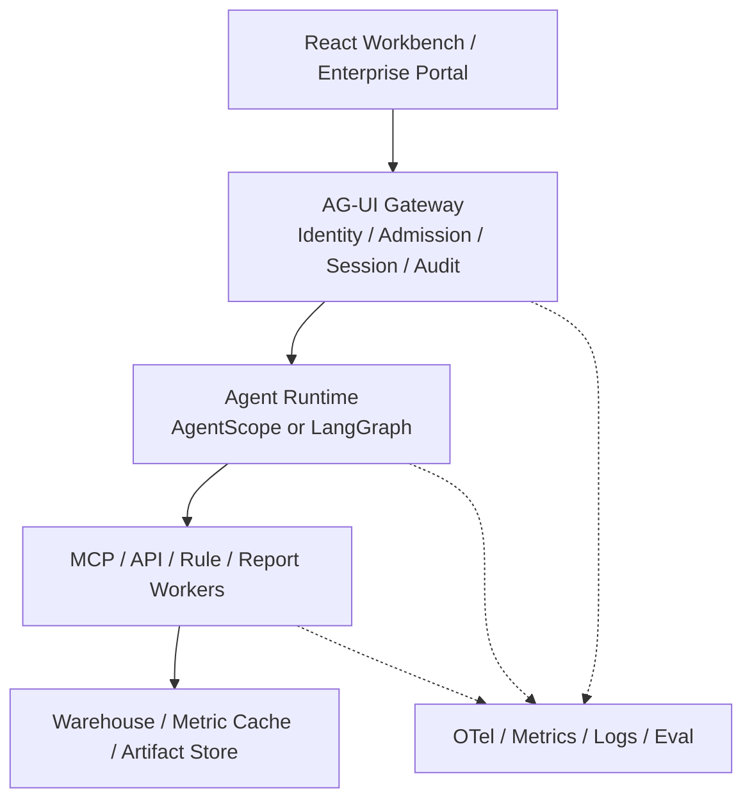

# AgentScope 与 LangChain/LangGraph 企业级工程选型报告

> 调研日期：2026-11-02  
> 适用项目：家宽智能体平台  
> 当前运行时：AgentScope 2.0.10  
> 文档性质：选型调研，不替代正式 ADR

## 一、报告摘要

本报告首先区分三个技术层次，以避免“AgentScope 对比 LangChain”产生概念混淆：

1. **LangChain** 是模型、工具、Agent Harness 层，当前 `create_agent` 适合快速构建工具调用型 Agent。[^l-products]
2. **LangGraph** 是低层编排和持久化运行时，负责 Graph、Checkpoint、Interrupt、Streaming 和 Durable Execution。[^l-overview]
3. **LangSmith Agent Server / LangSmith Deployment** 才是与 AgentScope Agent Service 同层的企业服务平台。它不是 LangGraph 开源核心，生产自托管需要 LangSmith 许可证、Postgres、Redis 和额外基础设施。[^l-agent-server][^l-deploy]

因此，当项目提出采用 LangChain 时，需要进一步明确目标层次：

- 用 LangChain 写 Agent；
- 用 LangGraph 做状态化编排；
- 使用 LangSmith Agent Server 承载生产服务；
- 或仅使用 LangChain 生态中的模型、工具和人才。

这四种目标对应的工程量和采购风险存在显著差异。

### 1.1 结论

在当前工程基础上，继续采用 AgentScope 的综合实施成本最低；采用纯开源 LangGraph 自建企业服务层的实施成本最高。

具体判断如下：

| 方案 | 相对难度 | 适合情况 | 主要代价 |
|---|---:|---|---|
| 保留 AgentScope，补齐生产化能力 | 2/5 | 项目仅存在 LangChain 技术偏好，无强制替换要求 | AgentScope 仍是 Beta，分布式服务仍需完善 |
| LangChain 单 Agent POC | 1/5 | 先验证产品体验或模型能力 | 只证明 Agent，不证明企业服务 |
| LangChain + LangGraph + Agent Server | 3/5 | 项目明确要求 LangChain，并可接受商业运行时 | 许可证、Postgres、Redis、LangSmith 部署形态 |
| LangGraph 纯开源 + 自建 FastAPI 服务 | 5/5 | 必须完全自主、完全开源、可接受长期平台开发 | 自建 Session、Run Queue、鉴权、Workspace、调度、观测 |

**建议路线：**

1. 项目未提出强制替换运行时要求时，建议保留 AgentScope，将预算投入多副本、Postgres/Redis、OTel、安全审计、Workspace 和压测。
2. 项目明确要求 LangChain/LangGraph 时，优先评估 LangGraph + Agent Server，并先确认许可证、网络、数据驻留和离线部署条件。
3. 必须采用纯开源方案时，应将 LangGraph 定位为编排库；安装 `langgraph` 不等同于获得完整企业 Agent 服务，需明确自建服务层范围。
4. 无论选哪条路线，都通过现有 `AgentRunBackend` 防腐边界新增适配器，不重写 React、MCP、Artifact 和业务评测。

### 1.2 发布状态与许可证表述

结合官方发布元数据，建议在项目评审材料中统一采用以下表述：

> AgentScope 2.x 的 Agent Service 能力较完整，但 PyPI 发布状态仍是 Beta；
> LangGraph/LangChain 核心库是 Production/Stable，但其生产 Agent Server 采用商业许可证模式。[^a-pypi][^l-pypi]

该差异直接影响方案评审中的供应链稳定性和版本治理判断。

## 二、调研方法与边界

本次调研基于以下证据：

- 仓库当前代码、测试、部署资产和 ADR；
- AgentScope 2.0.10 已安装源码及对应版本官方文档；
- AgentScope 2.0.11、LangChain 1.4.7、LangGraph 1.2.19 的 PyPI 元数据；
- LangChain/LangGraph 官方文档；
- 对 LangGraph 1.2.19 的本地最小实验，验证了 `StateGraph`、Checkpointer 和 `interrupt()`/`Command(resume)` 的基本运行方式。

本文不估算以下工作：

- 家宽指标、规则、数据质量和专业模型本身的建设；
- 企业 SSO、堡垒机、审批流、安全测评等组织集成；
- 生产网络、证书、镜像仓库和采购流程；
- 20 余项业务能力的领域开发。

这些工作无论采用 AgentScope 还是 LangGraph，均属于项目实施的必要内容。

## 三、当前工程基线

当前仓库不是单纯的 Prompt Demo，已经形成一条可运行的企业原型链路：

```text
React Workbench
    -> AG-UI Gateway
    -> AgentScope Agent Service
    -> Home Broadband MCP
    -> SQLite 指标缓存 / CSV
```

当前代码事实：

- 注册 1 个综合入口和 2 个领域 Agent，见 [ADR-003](../adr/003-multi-agent-workbench.md)；
- Gateway 已具备身份解析、Trusted Header、准入、Session、HITL、审计和 AG-UI 事件转换；
- MCP 提供 4 个只读参数化工具，不接受模型生成的 SQL；
- 前端支持 Agent 下拉、会话历史、工具确认和 Artifact；
- 平台、Gateway、契约、Agent、MCP 共约 5,560 行 Python；
- 测试约 2,786 行；
- 本次验证 `uv run pytest -q` 为 **78 项通过**。

主要目录：

```text
src/agent_platform/          AgentScope 运行时装配
src/agent_gateway/           AG-UI/BFF、身份、准入、会话、事件
src/agent_contracts/         共享契约
src/agents/home_broadband/   Agent 和 Skill
src/mcp_servers/             领域 MCP 与数据访问
web/agent-workbench/         React 工作台
deploy/                      Docker/K8s
```

### 3.1 平台耦合点

当前 AgentScope 耦合主要集中在以下文件：

- [agent_platform/app.py](../../src/agent_platform/app.py)：`create_app`、Storage、MessageBus、WorkspaceManager；
- [agent_platform/workspace.py](../../src/agent_platform/workspace.py)：Agent 级 Skill/MCP 资源策略；
- [agent_platform/provisioning.py](../../src/agent_platform/provisioning.py)：按用户 namespace 注册 Agent；
- [agents/home_broadband/agent.py](../../src/agents/home_broadband/agent.py)：`AgentData`、`ContextConfig`、`ReActConfig`；
- [agent_gateway/backend.py](../../src/agent_gateway/backend.py)：AgentScope HTTP 适配；
- [agent_gateway/event_converter.py](../../src/agent_gateway/event_converter.py)：AgentScope Event 到 AG-UI Event/Artifact。

### 3.2 已具备的框架解耦边界

[agent_gateway/protocol.py](../../src/agent_gateway/protocol.py) 中的 `AgentRunBackend` Protocol 是本次选型中最重要的现有资产。

它已经把 Gateway 需要的运行时能力抽象为：

- 列 Agent；
- 准备 Run；
- 流式事件；
- Session 生命周期；
- Interrupt；
- 工具确认；
- 历史消息。

这意味着替换运行时不必重写整个 Gateway，也不应让 LangGraph 类型扩散到 React 和业务契约。

### 3.3 当前生产化缺口

当前配置仍是单机原型配置：

- [agent_platform/app.py](../../src/agent_platform/app.py) 使用 SQLite `AsyncSQLAlchemyStorage`；
- 使用 `InMemoryMessageBus`；
- 使用 `LocalWorkspaceManager`；
- [deploy/k8s/stack.yaml](../../deploy/k8s/stack.yaml) 为单副本 `Recreate` 和 `ReadWriteOnce` PVC；
- [agent_gateway/admission.py](../../src/agent_gateway/admission.py) 的并发计数保存在进程内；
- AgentScope OTel 依赖已经安装，但项目尚未接入 `TracingMiddleware`；
- 默认审计是 Best-effort 日志，尚未接企业 SIEM/审计库。

这些问题与选 AgentScope 还是 LangGraph 无关，任何生产方案都必须解决。

## 四、框架定位与能力对比

### 4.1 正确的比较层级

不应该直接比较“AgentScope vs LangChain”，而应比较：

| 层次 | AgentScope 方案 | LangChain 生态方案 |
|---|---|---|
| Agent 开发 | `Agent`、`ReActConfig`、Toolkit | `create_agent`、LangChain Middleware |
| 确定性编排 | Pipeline、TeamPipeline | `StateGraph`、Functional API |
| 状态与恢复 | AgentService Session、状态保存 | Checkpointer、Store、Interrupt |
| 企业服务 | AgentScope Agent Service | LangSmith Agent Server 或自建服务 |
| 工作区 | Local/Docker/K8s/云 Sandbox | Deep Agents Backend 或自建 |
| 可观测性 | OpenTelemetry Middleware | LangSmith 或自行接 OTel |

### 4.2 核心能力矩阵

| 能力 | AgentScope 2.0.10/2.0.11 | LangGraph 开源核心 | LangGraph + Agent Server |
|---|---|---|---|
| 工具调用 Agent | 原生 ReAct | 原生 | 原生 |
| 状态化 Graph | 有 Pipeline，但主要围绕 Agent | 强，底层能力核心 | 强 |
| Durable Execution | Agent Service 会话与后台任务 | 有 Checkpoint、Retry、Resume | 有，服务化更完整 |
| 人工审批 | 原生 `RequireUserConfirmEvent` | `interrupt()`/`Command(resume)` | 原生服务 API |
| Session/Thread | 原生 Session API | 需自建 API，底层用 Checkpointer | 原生 Threads API |
| Run Queue | 有任务机制，分布式仍标 WIP | 无完整生产队列 | 有持久化队列与 Worker |
| 多 Agent Team | 原生 Team Tools | Subgraph/Subagent/Handoff/Router | 仍主要靠 Graph |
| Skill | 原生 `SKILL.md` 加载器 | Skills 是模式，需实现加载器 | 可用 Middleware |
| MCP | 原生 MCP Client | `langchain.mcp` 当前 Beta | 可复用 |
| Workspace/Sandbox | 服务层原生支持 | 不自带完整服务 | 有 Sandbox，但不等同 AgentScope Workspace |
| Cron | Agent Service 内置 | 自建 | 内置 |
| 企业身份 | 只有可替换 `user_id` 依赖 | 完全自建 | Auth Hook，仍需实现企业认证授权 |
| 多租户 | 按 `user_id` 所有权隔离 | 完全自建 | 资源级 Auth 需配置 |
| 可观测性 | OTel Middleware | 可接 OTel/LangSmith | LangSmith 原生 |
| 当前工程连续性 | 最高 | 低 | 中低 |

### 4.3 AgentScope 的真实优势

根据官方 Agent Service 文档，AgentScope 已经处理了大量服务层公共问题：

- Agent 与 Session 路由；
- 每用户资源生命周期；
- Session 持久化与 SSE Replay；
- 工具结果 Offload；
- Cron；
- Workspace 隔离；
- MCP、Skill 和 Credential 管理；
- HITL；
- Agent Team；
- AG-UI/A2A 协议适配。[^a-service]

Workspace 后端可选 Local、Bubblewrap、Docker、E2B、Daytona、OpenSandbox 和 Kubernetes。
隔离粒度支持 `per_agent`、`per_session`、`per_user`。[^a-workspace]

这对当前家宽项目尤其有价值，因为未来接入终端、工单、报告和代码类工具后，文件系统与执行环境会成为真实需求。

### 4.4 AgentScope 的真实风险

**第一，发布状态仍是 Beta。**

当前项目锁定的 `agentscope==2.0.10` 和最新 `2.0.11` 在 PyPI 上都标记为 `Development Status :: 4 - Beta`。[^a-pypi]

这不表示不能用，但要求：

- 锁定精确版本；
- 不连续跨多个 Minor 升级；
- 为 AgentScope 适配层准备契约测试；
- 保留切换到其他运行时的边界。

**第二，企业身份不由框架提供。**

AgentScope 明确说明没有内置用户认证，只使用占位 `X-User-ID` Header。
它所说的 Multi-tenant 是按 `user_id` 隔离资源，不包含组织、角色、用户目录和 SSO。[^a-service]

因此：

- 现有 HMAC Trusted Header Identity 应保留；
- AgentScope 端口只能由 Gateway 访问；
- 角色、数据域、字段权限仍由 Gateway 和 MCP 双重校验；
- 企业组织模型不能寄希望于 AgentScope 内置。

**第三，分布式部署仍标注 WIP。**

AgentScope 2.0.10/2.0.11 文档称 Redis Storage、Redis Bus 使多进程/多节点成为可能，但能力表仍标记 `Distributed deployment WIP`。[^a-service]

这不是说不能做，而是不能把文档中的 Demo 配置直接当作生产 HA 证明。
上线前必须做：

- Postgres/Redis 故障切换测试；
- 多副本 Session Lock 测试；
- 调度器单实例测试；
- 跨副本 SSE Replay 测试；
- 事件游标和幂等测试；
- AgentScope 版本升级回归。

**第四，MCP 2.x 升级存在断点。**

当前项目使用 `agentscope 2.0.10` 和 `mcp 1.30.0`。
AgentScope `2.0.11` 的依赖已经变为 `mcp>=2.0.0`，而当前项目声明 `mcp>=1.29,<2`。

因此升级 AgentScope 时不能只改一个版本号，必须同步完成 MCP SDK 2.x 兼容验证。

### 4.5 LangGraph 的真实优势

LangGraph 的强项不在“帮你生成 Agent 服务 API”，而在可控、可恢复的状态机：

- Graph 中可混合确定性步骤和模型步骤；
- Checkpointer 保存每个 Thread 的状态；
- Store 保存跨 Thread 长期记忆；
- `interrupt()` 可以暂停并在之后恢复；
- 支持 Node Timeout、Retry、Error Handler；
- 支持 Event Streaming；
- 支持 Time Travel 与状态历史；
- 对复杂业务流和确定性计算有更强表达力。[^l-overview][^l-persist][^l-interrupt][^l-fault]

对于“报告生成、异常定位、跨系统证据归集、人工审批、长任务恢复”这类流程，LangGraph 的模型比 AgentScope 当前以 Agent 为中心的抽象更自然。

### 4.6 LangGraph 的真实代价

**第一，LangGraph 不是完整企业服务。**

开源 `langgraph` 提供运行时和 Checkpointer，但不会自动提供：

- 企业 SSO；
- 多租户权限管理；
- Agent 管理 API；
- Session 管理 API；
- Run 队列；
- Worker 编排；
- Cron；
- Artifact 服务；
- Workspace；
- 审计与配额。

这些需要自建，或交给 Agent Server。

**第二，Agent Server 不是无条件的开源服务。**

LangSmith Agent Server 提供 Assistants、Threads、Runs、Cron、Streaming、HITL、持久化和任务队列。[^l-agent-server]

但：

- LangGraph/LangChain 核心库是 MIT；
- `langgraph-api` 服务包当前使用 Elastic-2.0，不是 MIT；[^l-api]
- 本地 `langgraph dev` 是内存开发服务器；
- 生产环境官方要求使用持久化后端或 LangSmith Deployment；
- 自托管 Standalone Server 需要 `LANGGRAPH_CLOUD_LICENSE_KEY`；
- 需要 Postgres、Redis；
- 非 Air-gapped 模式还需要访问 `beacon.langchain.com` 做许可证校验和 Usage Reporting。[^l-local][^l-deploy]

对于国内企业私有化环境，这些条件必须在项目启动前确认，而不是开发完成后再补。

**第三，Agent Server 的目录只解决 Graph，不解决完整业务平台。**

官方最小结构是：

```text
my-app/
├── my_agent/
│   ├── utils/
│   │   ├── tools.py
│   │   ├── nodes.py
│   │   └── state.py
│   ├── __init__.py
│   └── agent.py
├── .env
├── requirements.txt
└── langgraph.json
```

它适合部署 Graph，但家宽项目仍需要 Gateway、鉴权、Artifact、数据权限和评测。

**第四，MCP 集成仍在变化。**

LangChain 1.4 的 `langchain.mcp` 原生命名空间仍是 Beta，官方建议旧项目从独立 `langchain-mcp-adapters` 迁移。[^l-mcp]

这不阻碍 PoC，但需要锁定版本和做 MCP 契约测试。

## 五、目标企业架构

无论选哪个框架，建议保持同一套分层：



原则：

1. 浏览器永远不直接访问 Runtime；
2. Runtime 永远不直接连接业务数据库；
3. 模型不生成任意 SQL；
4. 指标、规则和权限由确定性服务执行；
5. Artifact 是浏览器协议，不绑定 Agent 框架；
6. Runtime 通过 Adapter 接入，不让框架类型扩散到业务层。

### 5.1 推荐的运行时接口

在现有 `AgentRunBackend` 基础上继续稳定以下语义：

```python
class AgentRunBackend(Protocol):
    async def list_agents(...): ...
    async def prepare(...): ...
    def stream(...): ...
    async def list_sessions(...): ...
    async def load_history(...): ...
    async def interrupt(...): ...
    async def confirm_tool_calls(...): ...
```

然后实现：

```text
agent_gateway/backends/
├── agentscope.py
└── langgraph.py
```

事件转换为内部统一类型：

```text
run_started
text_delta
reasoning_delta
tool_started
tool_args
tool_finished
tool_result
approval_required
artifact
run_error
run_finished
```

这样前端只依赖 AG-UI 和 Artifact，不需要知道后端框架。

## 六、AgentScope 工程目录方案

### 6.1 推荐目录

```text
src/
├── agent_platform/
│   ├── app.py
│   ├── runtime.py
│   ├── provisioning.py
│   ├── applications/
│   │   ├── registry.py
│   │   └── profiles.py
│   ├── infrastructure/
│   │   ├── storage.py
│   │   ├── message_bus.py
│   │   └── workspace.py
│   ├── security/
│   │   ├── resource_policy.py
│   │   └── middleware.py
│   └── telemetry.py
├── agent_gateway/
│   ├── api/
│   ├── identity/
│   ├── admission/
│   ├── sessions/
│   ├── eventing/
│   ├── artifacts/
│   └── backends/
│       └── agentscope.py
├── agent_contracts/
│   ├── artifacts.py
│   ├── events.py
│   └── capability.py
├── agents/
│   └── home_broadband/
│       ├── agent.py
│       ├── application.py
│       ├── skill_catalog.py
│       └── skills/
├── mcp_servers/
│   └── home_broadband/
├── home_broadband_agent/
│   └── config.py
web/agent-workbench/
deploy/
├── docker/
├── kubernetes/
└── helm/
tests/
├── unit/
├── integration/
├── contract/
└── eval/
docs/
├── architecture/
├── adr/
└── runbooks/
```

### 6.2 当前目录应保留的重点

- AgentScope App 只做装配，不承载家宽业务规则；
- Agent Gateway 与 Agent Runtime 分进程；
- MCP Server 独立进程，领域共享；
- Agent 与 Skill 资源策略按 Agent ID 隔离；
- 评测、Artifact、Audit 不依赖具体 Agent 框架。

### 6.3 必须补齐的平台项

| 项目 | 当前状态 | 生产目标 |
|---|---|---|
| Storage | SQLite | Postgres，带迁移、备份、恢复 |
| MessageBus | InMemory | Redis，跨副本锁、Replay、Wakeup |
| Workspace | Local | K8s/Docker Sandbox，TTL、配额、清理 |
| Scheduler | 进程内 APScheduler | 单 Scheduler 实例或独立调度服务 |
| Admission | 进程内计数 | Redis 分布式限流、租户配额 |
| Identity | Dev/HMAC Header | 企业 SSO + HMAC/JWT + 网关白名单 |
| Authz | Gateway + MCP 部分 | 用户、租户、角色、数据域、字段权限 |
| OTel | 未装配 | LLM/Tool/Reply Span、Trace 关联 |
| Audit | 日志 Best-effort | 持久审计、SIEM、保留策略 |
| Secret | 环境变量/凭证 API | Vault/KMS，按租户隔离 |
| HA | 单副本 | HPA、PDB、Graceful Drain、故障演练 |
| Eval | 已有家宽评测 | 每次发布自动跑回归、路由、工具选择 |

### 6.4 AgentScope 结论

**如果目标是以最小代价把现有家宽 Agent 做成企业服务，AgentScope 是更短路径。**

它不是因为它“更强大”，而是因为当前实现已经覆盖了最难替换的服务层：Session、Workspace、Skill、MCP、HITL、Event Stream 和多 Agent 注册。

但必须接受三个前提：

1. 框架仍是 Beta；
2. 企业身份和权限仍由我们承担；
3. 分布式部署需要自行验证，不能只依赖文档声明。

## 七、LangChain/LangGraph 工程目录方案

### 7.1 方案 A：LangGraph 纯开源 + 自建服务

适合完全自主、无商业运行时依赖、团队愿意长期维护平台层的情况。

```text
langgraph.json
src/
├── agent_service/
│   ├── app.py
│   ├── auth.py
│   ├── tenancy.py
│   ├── admission.py
│   ├── assistants.py
│   ├── sessions.py
│   ├── runs.py
│   ├── scheduler.py
│   ├── credentials.py
│   └── audit.py
├── agent_runtime/
│   ├── registry.py
│   ├── checkpoints.py
│   ├── store.py
│   ├── queue.py
│   ├── worker.py
│   ├── cancellation.py
│   ├── events.py
│   └── telemetry.py
├── agent_gateway/
│   ├── api/
│   ├── identity/
│   ├── eventing/
│   └── backends/
│       └── langgraph.py
├── agents/
│   └── home_broadband/
│       ├── graph.py
│       ├── state.py
│       ├── context.py
│       ├── middleware.py
│       ├── nodes/
│       │   ├── classify.py
│       │   ├── resolve_scope.py
│       │   ├── load_skill.py
│       │   ├── call_tools.py
│       │   ├── approval.py
│       │   └── synthesize.py
│       ├── prompts/
│       ├── policies.py
│       └── skills/
├── agent_contracts/
├── mcp_servers/
│   └── home_broadband/
└── home_broadband_agent/
web/agent-workbench/
deploy/
tests/
```

自建服务必须明确负责：

- Run Queue；
- Worker Lease；
- Exactly-once/At-least-once 语义；
- Thread 级单 Run 串行；
- 取消与 Rollback；
- Retry 与 Dead Letter；
- Graceful Drain；
- Session 列表与标题；
- 租户和资源授权；
- Long-term Store 隔离；
- Scheduled Run；
- SSE Replay；
- Artifact 持久化；
- Usage 与配额。

这些正是 Agent Server 的商业价值，也是纯开源路线的主要工作量。

### 7.2 方案 B：LangChain + LangGraph + Agent Server

若项目已具备或计划采购 LangSmith Deployment，目录可以明显收缩：

```text
langgraph.json
src/
├── home_broadband_agent/
│   ├── graph.py
│   ├── state.py
│   ├── context.py
│   ├── middleware.py
│   ├── auth.py
│   ├── assistants.py
│   ├── nodes/
│   ├── tools/
│   ├── prompts/
│   └── skills/
├── agent_gateway/
│   ├── identity/
│   ├── eventing/
│   └── backends/
│       └── langgraph_server.py
├── agent_contracts/
├── mcp_servers/
│   └── home_broadband/
└── home_broadband_agent/
web/agent-workbench/
deploy/
```

Agent Server 提供：

- Assistants；
- Threads；
- Runs；
- Cron；
- Postgres Checkpoint；
- Long-term Store；
- Durable Queue；
- SSE；
- Cancel；
- HITL；
- Auth Hook；
- Resource Authorization。[^l-agent-server][^l-auth]

仍需自建：

- 企业 SSO 对接；
- 家宽数据域和字段权限；
- MCP 工具内部权限；
- Artifact Schema 和持久化策略；
- AG-UI 事件适配；
- 租户级配额和成本控制；
- 家宽评测和发布门禁；
- 许可证、Postgres、Redis、Helm 和网络。

### 7.3 方案 C：只做一个领域 Agent 的兼容 Adapter

这是最稳妥的验证路径：

1. 保持 AgentScope 主线不变；
2. 新建 `LangGraphBackend`；
3. 只迁移 `home_broadband_data_agent`；
4. 复用同一个 MCP、Artifact 和 Gateway；
5. 对两个后端跑同一套端到端评测；
6. 再决定是否整体迁移。

验证范围必须覆盖：

- Agent 列表；
- 新建与会话恢复；
- 流式文本；
- 工具调用；
- Artifact；
- HITL；
- 取消；
- 进程重启恢复；
- 权限拒绝；
- 多租户隔离；
- 历史消息重建。

## 八、迁移映射与复用边界

### 8.1 代码复用矩阵

| 资产 | 迁移到 LangGraph 的复用度 | 说明 |
|---|---:|---|
| 家宽 MCP Server | 90% 至 100% | 协议边界不变，主要做兼容测试 |
| React Workbench | 90% 至 100% | 继续消费 AG-UI 和 Artifact |
| Artifact Schema | 80% 至 100% | 与 Agent 框架解耦 |
| Agent Skill 文本 | 70% 至 90% | 内容可保留，加载器要重写 |
| Gateway 身份/审计/准入 API | 50% 至 80% | 业务逻辑可保留，分布式实现要补 |
| Gateway Backend | 10% 至 30% | 几乎必须重写 |
| Event Converter | 10% 至 30% | LangGraph 事件模型不同 |
| Agent 装配 | 0% 至 20% | `AgentData` 与 Graph/Agent 不同 |
| 领域评测集 | 70% 至 90% | 输入输出可复用，执行器要改 |
| 部署资产 | 30% 至 60% | 镜像、探针可复用，组件拓扑需改 |

### 8.2 当前文件迁移建议

| 当前实现 | LangGraph 对应 | 额外开发 |
|---|---|---|
| `AgentData` | `create_agent` 或 `StateGraph` | Agent 装配、Prompt 注入、模型配置 |
| AgentScope Skill | Custom Middleware / Skill Loader | 目录扫描、权限过滤、Prompt 注入 |
| `MCPClient` | `MCPAdapter` | Tool 映射、结果结构、错误语义 |
| `/agents` | Assistant/Graph Registry | Agent 配置持久化 |
| `/sessions` | Thread + Checkpointer | 标题、状态、业务元数据 |
| `/chat` | `/runs` | Gateway Backend 重写 |
| Session SSE | LangGraph Event Stream | 事件游标、Replay、AG-UI 映射 |
| `RequireUserConfirmEvent` | `interrupt()` + `Command(resume)` | Reply/Tool Call ID 映射 |
| Workspace Policy | Runtime Context + Middleware | Workspace 分配、TTL、MCP/Skill 隔离 |
| Credential | 模型网关/Secret Manager | 租户凭据和轮换 |
| Schedule | Agent Server Cron 或自建 | 调度器、幂等、补跑 |
| Agent Team | Subgraph/Subagent/Handoff | 没有同名一站式 Team Service |

### 8.3 不应迁移的内容

以下内容不要为了换框架而重写：

- 指标字典、区域维表和查询 Repository；
- 只读参数化 MCP 工具；
- Capability Result；
- 数据质量 Warning；
- Artifact 前端渲染；
- 现有域测试和评测样例；
- Gateway 的 HMAC 身份校验；
- 审计不记录用户消息正文的约束。

## 九、工作量评估

估算基准：

- 1 名熟悉 Python、FastAPI 和 Agent 框架的高级工程师；
- 复用当前 MCP、Artifact、React 和评测；
- 不含业务需求新增、安全测评和采购；
- 误差按正负 30% 理解。

| 路线 | 工作内容 | 预计人日 | 单人日历周 |
|---|---|---:|---:|
| 保留 AgentScope | Postgres/Redis、HA、身份权限、Workspace、OTel、审计、压测 | 20 至 35 | 4 至 7 |
| LangChain 领域 POC | 单 Agent、MCP、基本流式、无完整企业服务 | 3 至 5 | 1 |
| LangGraph + Agent Server | Graph、Auth、Artifact、Gateway 适配、部署、回归 | 25 至 40 | 5 至 8 |
| LangGraph 纯开源 | 上述工作加线程、队列、Worker、调度、SSE、容灾 | 40 至 65 | 8 至 13 |
| 双运行时长期维护 | 两套版本、事件、HITL、Session、测试矩阵 | 持续增加 20% 至 35% 维护成本 | 不推荐长期并行 |

### 9.1 主要工作量风险

1. **会话语义**：AgentScope Session 和 LangGraph Thread 的 ID、状态、历史、标题和 Artifact 归属不同。
2. **事件语义**：Token、Reasoning、Tool Call、HITL 和 Run Finish 的顺序不同。
3. **工具确认**：LangGraph 的 Interrupt ID 和 AgentScope 的 Reply ID/Tool Call ID 需要稳定映射。
4. **重启恢复**：必须验证运行中进程被杀后，线程能继续而不是从头重复副作用。
5. **权限隔离**：Runtime 权限和 MCP 数据权限必须同时存在。
6. **版本兼容**：LangGraph 最新 Graph 代码会作用于旧 Checkpoint，State/Node 变更必须考虑 Backward Compatibility。[^l-compat]
7. **调度一致性**：多副本下 Cron 只能执行一次。
8. **AG-UI 适配**：框架有 Streaming 不等于已有符合现有前端的 AG-UI 语义。

## 十、风险清单

| 风险 | AgentScope | LangGraph | 应对 |
|---|---|---|---|
| 框架 Beta/API 变化 | 高 | 核心低，Agent Server 需看版本 | 锁版本、契约测试、适配层 |
| 企业身份缺口 | 高 | 高 | Gateway 统一 IAM，Runtime 仅信任内网 Header |
| 分布式队列与 HA | 中高 | 纯开源高 | 采用成熟运行时或明确自建范围 |
| 许可证与采购 | 低 | Agent Server 高 | 项目启动前确认 License 和离线模式 |
| Workspace 隔离 | 服务层较完整 | 需自建或 Deep Agents | 生产禁用裸 Local 执行 |
| MCP 版本兼容 | 2.0.11 有 2.x 断点 | `langchain.mcp` 仍 Beta | 固定 MCP 契约，跑双版本集成测试 |
| Checkpoint/State 演进 | Session 模型升级风险 | Graph 兼容风险较高 | 加 State 版本、Drain、回滚演练 |
| 可观测性 | 已提供 OTel，未装配 | LangSmith 强，自建需 OTel | 发布前统一 Trace ID 和工具 Span |
| 供应商锁定 | 中 | Agent Server 高 | 保留 Adapter、MCP 和 Artifact 契约 |
| 人才可获得性 | 国内资料较好，生态较窄 | 生态和招聘更强 | 通过 Adapter 限制知识集中在平台组 |

## 十一、推荐决策

### 11.1 项目未提出强制框架要求

**推荐 AgentScope。**

理由：

- 当前代码已经端到端跑通；
- 78 项测试可作为迁移基线；
- Skill、Session、Workspace、MCP、HITL 和事件层已经存在；
- 切换到 LangGraph 不能自动带来企业级安全或数据治理；
- 预算应优先投入产品能力、数据语义、权限和可靠性。

### 11.2 项目明确要求 LangChain/LangGraph

按以下顺序决策：

1. **有 LangSmith 许可证、允许 Postgres/Redis、可接受部署形态**：选择 LangChain + LangGraph + Agent Server。
2. **必须纯开源、内网离线、无商业运行时**：选择 LangGraph + 自建 FastAPI 服务，并显式列出平台层工作。
3. **仅希望使用 LangChain 编写 Agent**：采用 `create_agent` 做领域 Agent POC，但不据此废弃现有平台。
4. **仅为团队对生态的偏好**：保留 AgentScope，允许后续通过 `LangGraphBackend` 平滑演进。

### 11.3 推荐迁移步骤

1. 第 1 周：冻结 `AgentRunBackend`、Artifact、MCP、HITL 和 Session 契约。
2. 第 2 至 3 周：实现 LangGraph 单领域 Agent 与 MCP 适配。
3. 第 3 至 5 周：实现 Session、History、Streaming、Interrupt 和 Artifact 映射。
4. 第 5 至 7 周：接入网关身份、权限、审计、指标和压测。
5. 第 7 至 8 周：用现有 78 项测试及家宽评测做双后端对照。
6. 通过验收后再决定整体迁移，期间不删除 AgentScope 主线。

### 11.4 选型前置确认事项

1. LangChain 使用要求属于强制技术标准，还是团队技术偏好？
2. 生产服务是否限定为 LangSmith Agent Server，或仅允许使用 MIT 核心库？
3. 部署环境是否允许 Postgres、Redis 和外网 License Reporting？
4. 项目是否具备可用的 LangSmith Enterprise/Standalone License？
5. Agent Runtime 的 IAM、租户、队列、调度、Workspace 和观测由哪一方负责？
6. 是否接受为框架切换新增 4 至 10 周工作量，且不增加业务能力？

## 十二、验收基线

无论最终选择哪个框架，企业级验收至少覆盖：

### 功能

- 综合入口和领域 Agent 可选；
- 指标检索、趋势、排名和装维质量可查询；
- Artifact 正确持久化和恢复；
- HITL 允许批准、拒绝和恢复；
- 用户可取消正在运行的 Run；
- 进程重启后可恢复已持久化 Thread；
- 多轮历史不会串 Session。

### 安全

- 浏览器不能直连 Runtime 或 MCP；
- 伪造 Header 不能绕过身份；
- 跨租户、跨用户资源不可见；
- MCP 再次校验数据权限；
- Secret 不进入 Prompt、日志和 Artifact；
- 审计记录包含主体、动作、资源、结果和 Trace ID。

### 可靠性

- 多副本下同一 Session 不允许并行写；
- Cron 不重复执行；
- Redis/Postgres 短暂故障后可恢复；
- SSE 断线重连不丢最终结果；
- Worker 崩溃后不重复副作用；
- 发布期间 In-flight Run 有 Drain 或兼容策略。

### 观测与效果

- 每次 LLM、Tool、Agent、Gateway 调用可串成同一 Trace；
- 可统计并发、排队时间、首 Token 时间、工具错误率和 Token 成本；
- 指标口径、工具选择和回答质量通过固定评测集；
- 框架升级前跑完整回归。

## 十三、最终判断

本次选型的核心判断在于各技术层的职责边界，而非单一框架的能力排名。

- AgentScope 更接近完整的 Agent 服务平台，当前项目能直接复用；
- LangChain 更接近 Agent 开发框架，适合快速写领域 Agent；
- LangGraph 是更强的状态编排和持久化运行时；
- Agent Server 是 LangGraph 的生产服务形态，但涉及商业许可证和额外基础设施。

从当前家宽项目的代码基础、交付确定性、企业集成和迁移成本看：

> **第一推荐：保留 AgentScope 并补齐生产化。**
>
> **项目存在硬性要求时：优先 LangGraph + Agent Server；不能使用商业运行时，再评估纯开源 LangGraph 自建。**
>
> **不建议仅以生态热度为依据进行整体重写。**

## 参考资料

[^a-service]: AgentScope 2.0.10 Agent Service Architecture: https://docs.agentscope.io/en/versions/2.0.10/deploy/agent-service
[^a-workspace]: AgentScope 2.0.10 Workspace Manager: https://docs.agentscope.io/en/versions/2.0.10/deploy/workspace-manager
[^a-pypi]: AgentScope PyPI: https://pypi.org/project/agentscope/2.0.11/
[^l-pypi]: LangChain and LangGraph PyPI metadata: https://pypi.org/project/langgraph/1.2.19/
[^l-api]: LangGraph API package and license: https://pypi.org/project/langgraph-api/0.17.0/
[^l-products]: LangChain, LangGraph and Deep Agents positioning: https://docs.langchain.com/oss/python/concepts/products
[^l-overview]: LangGraph overview: https://docs.langchain.com/oss/python/langgraph/overview
[^l-persist]: LangGraph persistence: https://docs.langchain.com/oss/python/langgraph/persistence
[^l-interrupt]: LangGraph interrupt: https://docs.langchain.com/oss/python/langgraph/interrupts
[^l-fault]: LangGraph fault tolerance: https://docs.langchain.com/oss/python/langgraph/fault-tolerance
[^l-compat]: LangGraph backward compatibility: https://docs.langchain.com/oss/python/langgraph/backward-compatibility
[^l-mcp]: LangChain MCP beta: https://docs.langchain.com/oss/python/langchain/mcp
[^l-agent-server]: LangSmith Agent Server: https://docs.langchain.com/langsmith/agent-server
[^l-local]: LangGraph local server: https://docs.langchain.com/oss/python/langgraph/local-server
[^l-deploy]: LangGraph standalone deployment and license: https://docs.langchain.com/langsmith/deploy-standalone-server
[^l-auth]: LangSmith Agent Server authentication: https://docs.langchain.com/langsmith/auth

